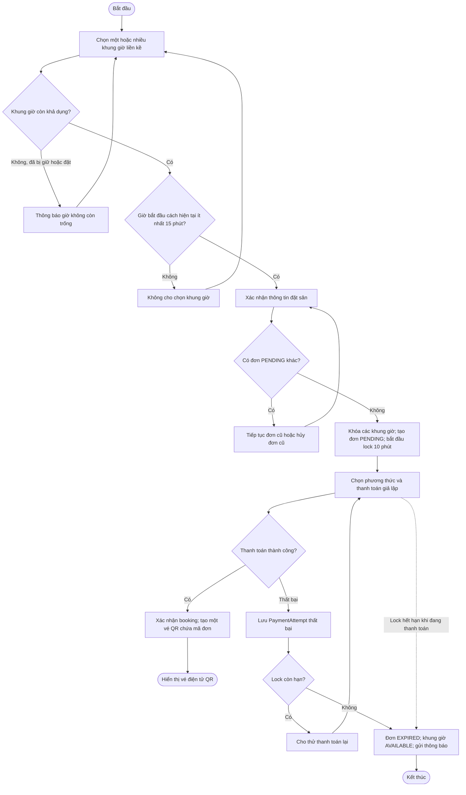
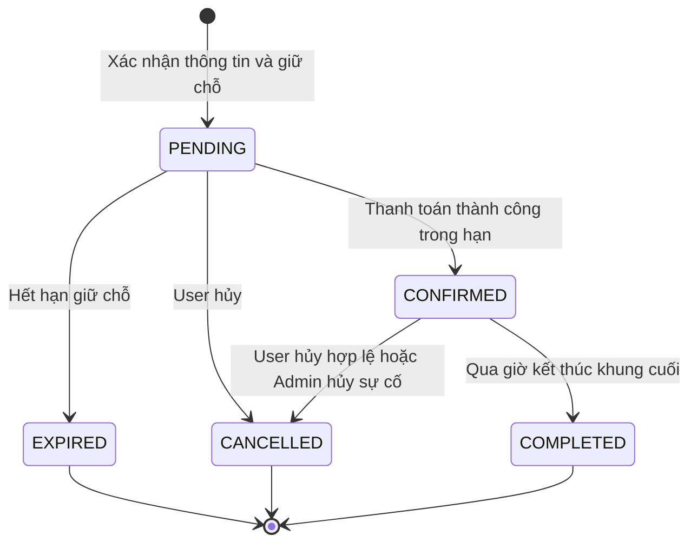

# Business Flow — SportBooking

> Tài liệu mô tả luồng nghiệp vụ web đặt sân thể thao SportBooking. Mã `FR-xx` và `UC-xx` được giữ nguyên theo [phiếu yêu cầu](./phieu-yeu-cau.md) để đối chiếu. Các quyết định đã chốt được ưu tiên khi có khác biệt với phiếu. Múi giờ nghiệp vụ: Việt Nam (UTC+7).

## Mục lục

- [1. Mục tiêu và phạm vi](#1-mục-tiêu-và-phạm-vi)
- [2. Vai trò và quyền](#2-vai-trò-và-quyền)
- [3. Luồng chính: từ trang chủ đến vé điện tử QR](#3-luồng-chính-từ-trang-chủ-đến-vé-điện-tử-qr)
- [4. Các luồng phụ](#4-các-luồng-phụ)
  - [4.1 Hủy đơn và hoàn tiền](#41-hủy-đơn-và-hoàn-tiền-fr-08-uc-08)
  - [4.2 Tìm đối, ghép và nới lỏng](#42-tìm-đối-ghép-và-nới-lỏng-fr-13fr-15-uc-13uc-15)
  - [4.3 Thông báo trong app](#43-thông-báo-trong-app-fr-17-uc-17)
  - [4.4 Đánh giá](#44-đánh-giá-fr-18-uc-18)
  - [4.5 Lịch sử](#45-lịch-sử-fr-09-uc-09)
  - [4.6 Admin](#46-admin-fr-04-fr-10-fr-11-fr-19-uc-04-uc-10-uc-11-uc-19)
- [5. Thực thể và quan hệ](#5-thực-thể-và-quan-hệ)
- [6. Bảng chuyển trạng thái](#6-bảng-chuyển-trạng-thái)
  - [6.1 Khung giờ](#61-khung-giờ)
  - [6.2 Đơn đặt](#62-đơn-đặt)
  - [6.3 Thanh toán](#63-thanh-toán)
  - [6.4 Yêu cầu tìm đối](#64-yêu-cầu-tìm-đối)
- [7. Quy tắc nghiệp vụ](#7-quy-tắc-nghiệp-vụ)
- [8. Bản đồ trang và điều hướng](#8-bản-đồ-trang-và-điều-hướng)
- [9. Trường hợp ngoại lệ và cách xử lý](#9-trường-hợp-ngoại-lệ-và-cách-xử-lý)
- [10. Các quyết định bổ sung](#10-các-quyết-định-bổ-sung)
- [11. Khác biệt so với phiếu](#11-khác-biệt-so-với-phiếu)

## 1. Mục tiêu và phạm vi

SportBooking giúp khách hàng tìm sân, đặt một hoặc nhiều khung giờ liền kề trên cùng sân và cùng ngày, thanh toán giả lập, quản lý lịch đặt, nhận thông báo và (nếu chọn) ghép đối. Admin quản lý dữ liệu sân và xử lý các đơn phát sinh sự cố.

| Nhóm | Phạm vi |
|---|---|
| **Cốt lõi** | Đăng ký/đăng nhập và phân quyền (`FR-01`, `UC-01`); hồ sơ cá nhân (`FR-03`, `UC-03`); quản lý cơ sở, sân, khung giờ và giá (`FR-04`, `UC-04`); tìm kiếm và xem sân (`FR-05`, `UC-05`); đặt sân và giữ chỗ (`FR-06`, `UC-06`); thanh toán giả lập (`FR-07`, `UC-07`); hủy và hoàn tiền (`FR-08`, `UC-08`); lịch sử đặt sân (`FR-09`, `UC-09`); quản lý người dùng (`FR-10`, `UC-10`); xử lý booking ngoại lệ (`FR-11`, `UC-11`); tự động xử lý đơn quá hạn (`FR-12`, `UC-12`); thông báo trong app (`FR-17`, `UC-17`); dashboard admin (`FR-19`, `UC-19`). |
| **Nâng cao** | Tìm đối ngẫu nhiên (`FR-13`, `UC-13`); tìm đối theo tiêu chí (`FR-14`, `UC-14`); hết hạn và người dùng chủ động nới lỏng tiêu chí (`FR-15`, `UC-15`); cập nhật trạng thái realtime (`FR-16`); đánh giá sân (`FR-18`, `UC-18`). |
| **Tùy chọn, làm sau cùng** | Email; quên mật khẩu; tin tức thể thao lấy từ RSS; xuất Excel. Các phần này không được trì hoãn luồng cốt lõi hoặc thông báo trong app. |
| **Ngoài phạm vi** | Khuyến mãi; thu hộ khoản đóng góp của người ghép; thanh toán/cổng ngân hàng thật; luồng khách gửi yêu cầu để admin duyệt. |

Thanh toán là giả lập, có lựa chọn đặt cọc 50% hoặc trả toàn bộ giá sân. Phần chưa thanh toán (nếu đặt cọc) được thu tại sân, không qua hệ thống. Phương thức hiển thị gồm chuyển khoản, ví MoMo, thẻ ATM nội địa và thẻ quốc tế; cổng giả lập có hai kết quả **Thành công** và **Thất bại**. Hệ thống lưu mọi lần thử thanh toán, kể cả thất bại, để đối soát.

Các môn có trong phạm vi là bóng đá mini, cầu lông và pickleball. Chỉ hiển thị lựa chọn thể thức đơn/đôi với môn hỗ trợ thể thức đó (cầu lông và pickleball có đơn/đôi, bóng đá mini không có).

## 2. Vai trò và quyền

| Vai trò | Quyền và giới hạn |
|---|---|
| **User** | Đăng ký, đăng nhập; quản lý hồ sơ của mình; tìm/xem sân; đặt và thanh toán đơn của mình; hủy đơn đủ điều kiện; xem lịch sử, thông báo; đánh giá đơn đã hoàn thành; tạo hoặc tham gia yêu cầu ghép đối theo điều kiện. Không được xem dữ liệu riêng của user khác, truy cập trang/API admin, hoặc tự sửa trạng thái đơn/thanh toán/khung giờ. |
| **Admin** | Truy cập dashboard; quản lý user; quản lý cơ sở, sân, khung giờ và giá; xem và tự hủy đơn cần xử lý ngoại lệ, kể cả đơn đang trong trận. Khi admin hủy vì sự cố như cháy/bão, hệ thống hoàn 100% số tiền khách đã trả và thông báo cho khách. Admin không duyệt các đơn đặt sân thông thường và không chờ khách gửi yêu cầu hủy ngoại lệ. |

**Quy tắc phân quyền:** mọi trang và thao tác phải được kiểm tra quyền ở hệ thống, không chỉ ẩn nút trên giao diện. User chỉ đọc/sửa tài nguyên thuộc mình. Admin không được tự khóa tài khoản đang đăng nhập. Tài khoản admin được cấp/quản lý riêng; không tự gán quyền admin qua đăng ký user.

## 3. Luồng chính: từ trang chủ đến vé điện tử QR

XRef chính: `FR-01`/`UC-01`, `FR-05`/`UC-05`, `FR-06`/`UC-06`, `FR-07`/`UC-07`, `FR-12`/`UC-12`, `FR-16`.

| Bước | Người dùng | Hệ thống | Dữ liệu đọc / ghi |
|---|---|---|---|
| 1. Vào hệ thống | Mở website. Nếu chưa đăng nhập, chọn đăng nhập bằng email và mật khẩu hoặc đăng ký; sau khi đăng ký, quay lại đăng nhập. Khi đăng ký, người dùng phải mở và cuộn đến hết cả **Điều khoản sử dụng** và **Chính sách bảo mật** thì ô đồng ý mới được bật; chỉ đăng ký thành công khi người dùng đã đánh dấu đồng ý. | Hai văn bản là trang công khai, xem được không cần đăng nhập và có liên kết ở footer chung trên mọi trang. Kiểm tra phiên. Phiên hết hạn sau 8 giờ; xác thực email, mật khẩu và vai trò. Điều hướng user tới trang chủ, admin tới trang quản trị. | Đọc user, trạng thái tài khoản, email, thông tin xác thực và phiên; chỉ ghi user mới khi `termsAccepted = true`, đồng thời ghi `terms_accepted_at`; ghi phiên đăng nhập khi đăng nhập thành công (`FR-01`, `UC-01`). |
| 2. Chọn đường vào | Từ trang chủ chọn tìm sân, hoặc bấm **Đặt sân ghép đối ngay**. | Hiển thị các sân nổi bật và điều hướng tới tìm sân/đặt sân. Nút ghép đối mở luồng đặt sân với công tắc tìm đối bật sẵn; chưa tạo ghép nếu user chưa hoàn tất đặt sân. | Đọc sân, môn, khu vực và điểm đánh giá; chưa ghi đơn. |
| 3. Tìm và chọn sân | Lọc theo môn, khu vực, ngày/giờ; mở chi tiết sân rồi chọn **Đặt sân**. | Trả danh sách sân, thông tin chi tiết, giá, tiện ích, bản đồ, nội quy/chính sách hủy, đánh giá và trạng thái khung giờ mới nhất. Các môn hỗ trợ đơn/đôi mới hiển thị lựa chọn thể thức tương ứng. | Đọc cơ sở, sân, giá, đánh giá, lịch khung giờ và trạng thái giữ/đặt (`FR-05`, `UC-05`, `FR-16`). |
| 4. Chọn khung giờ | Chọn một hoặc nhiều khung giờ liền kề trên cùng sân và cùng ngày. | Chỉ cho chọn khung giờ khả dụng có giờ bắt đầu cách hiện tại ít nhất 15 phút. Giờ đã qua bị khóa. Khung đang được người khác giữ hiển thị **Đang được giữ chỗ** và không chọn được; khung đã bật tìm đối của một đơn đã xác nhận hiển thị **Xin ghép**. | Đọc khung giờ, giá, `lock_expires_at`, đơn và yêu cầu ghép liên quan. |
| 5. Xác nhận thông tin | Kiểm tra sân, ngày, các khung giờ, thông tin cá nhân, tổng giá; chọn đặt cọc 50% hoặc toàn bộ; có thể bật/tắt tìm đối và chọn ngẫu nhiên/theo tiêu chí, thể thức áp dụng, lời nhắn. | Kiểm tra lại tình trạng/giá và tính liền kề, cùng sân/ngày. Giá đơn bằng tổng giá đã cấu hình của từng khung (giờ vàng 17:00–21:00 giá cao hơn), không phụ phí. Mỗi user chỉ có tối đa một đơn `PENDING`: nếu đã có, cho tiếp tục đơn đó hoặc hủy đơn cũ trước khi tạo đơn mới. Chỉ cho bật tìm đối nếu giờ bắt đầu khung đầu cách hiện tại ít nhất 30 phút. Khi xác nhận đặt sân, bắt đầu giữ chỗ 10 phút và khóa nguyên tử tất cả khung giờ. | Đọc user, đơn `PENDING` hiện có, lịch và giá; ghi đơn `PENDING`, chi tiết các khung giờ kèm giá tại thời điểm đặt, lựa chọn thanh toán và `lock_expires_at`. |
| 6. Giữ chỗ và tiếp tục | Tiếp tục tới thanh toán hoặc rời trang rồi quay lại. | Cho chủ đơn tiếp tục thanh toán đơn `PENDING` còn hạn. User khác thấy **Đang được giữ chỗ**. Mọi truy vấn lịch trống coi lock đã quá hạn là trống; tác vụ nền mỗi phút chuyển đơn quá hạn thành `EXPIRED`, trả khung về `AVAILABLE` và gửi thông báo. | Đọc chủ đơn, trạng thái, `lock_expires_at` và giờ hiện tại; khi hết hạn ghi đơn `EXPIRED`, khung giờ `AVAILABLE` và tạo thông báo. |
| 7. Chọn phương thức và thanh toán | Chọn chuyển khoản, MoMo, ATM nội địa hoặc thẻ quốc tế; bấm **Thành công** hoặc **Thất bại** trên cổng giả lập. | Ghi nhận mọi lần thử, không giới hạn số lần trong thời hạn giữ chỗ. Với thành công, ghi số tiền user chọn trả, xác nhận đơn và chuyển các khung giờ sang đã đặt. Với thất bại, đơn vẫn `PENDING` đến hết hạn; user có thể thử lại khi lock còn hiệu lực. | Đọc đơn, tổng giá và giá đã chốt; ghi từng lần thử thanh toán, số tiền, phương thức, kết quả và thời điểm; cập nhật đơn/khung giờ khi thành công (`FR-07`, `UC-07`). |
| 8. Xác nhận đặt sân | Xem trang đặt sân thành công/chi tiết đơn và vé điện tử. | Tạo mã đơn duy nhất và **một vé QR duy nhất cho toàn bộ đơn**, kể cả đơn có nhiều khung giờ. Mã đơn và mã QR đều duy nhất, không trùng nhau. Hiển thị sân, toàn bộ khung giờ, hotline, bản đồ, giá, số tiền đã trả/còn phải trả tại sân, chính sách và QR. Phát thông báo trong app. | Ghi mã đơn, một vé/QR, trạng thái `CONFIRMED`, thông báo; đọc lại chi tiết sân/đơn/thanh toán. |
| 9. Bắt đầu tìm đối (nếu chọn) | Xem màn hình radar/đếm ngược tìm đối; chờ kết quả. | Sau khi đơn đã xác nhận, tạo yêu cầu tìm đối. Mỗi chu kỳ tìm kết thúc tại thời điểm sớm hơn giữa lúc bắt đầu chu kỳ + 10 phút và giờ bắt đầu khung đầu tiên - 10 phút. Khi ghép được, hiển thị kết quả cho B và gửi thông báo cho cả A và B. | Ghi yêu cầu `SEARCHING`, tiêu chí, lời nhắn, thời điểm bắt đầu/kết thúc chu kỳ; khi ghép ghi trạng thái, đối tác, mã kết nối trận và thông báo. |
| 10. Tiếp tục từ nơi đã dừng | Mở lại trang lịch sử/chi tiết đơn còn `PENDING` trước khi hết hạn. | Xác thực quyền sở hữu và thời hạn lock; trả về đúng đơn để tiếp tục thanh toán. Không gia hạn lock chỉ vì mở lại. Nếu đã hết hạn, báo rõ và đưa user về lịch trống. | Đọc đơn, khung giờ và `lock_expires_at`; không tạo đơn/lock trùng. |

Thời điểm giữ chỗ bắt đầu từ lúc user xác nhận thông tin đặt sân, không phải lúc bắt đầu tìm sân; chỉ dừng khi thanh toán thành công hoặc đơn hết/hủy. Đơn có thể chứa nhiều khung giờ nhưng các khung phải liền nhau, cùng sân và ngày. Mọi thời điểm/so sánh thời hạn tuân theo UTC+7.

## 4. Các luồng phụ

### 4.1 Hủy đơn và hoàn tiền — `FR-08`, `UC-08`

User có thể yêu cầu hủy đơn `PENDING` hoặc `CONFIRMED` thuộc mình, từ chi tiết đơn hoặc lịch sử. Hệ thống hiển thị sân, khung giờ, lý do (nếu được nhập) và khoản hoàn dự kiến trước khi xác nhận. Mốc tính thời gian hủy là giờ bắt đầu khung đầu tiên của đơn. Khi user xác nhận, hệ thống hủy đơn, giải phóng các khung giờ phù hợp, hủy yêu cầu tìm đối còn hoạt động và thông báo kết quả. Hủy `PENDING` chưa thanh toán thì không hoàn tiền.

| Thời điểm hủy trước giờ bắt đầu | Tỷ lệ hoàn | Cách tính |
|---|---:|---|
| Từ 24 giờ trở lên trước giờ bắt đầu khung đầu tiên | 100% | Tỷ lệ trên số tiền đã thanh toán |
| Từ 6 giờ đến dưới 24 giờ trước giờ bắt đầu khung đầu tiên | 50% | Tỷ lệ trên số tiền đã thanh toán |
| Dưới 6 giờ trước giờ bắt đầu khung đầu tiên | 0% | Không phát sinh hoàn |

User không thể hủy đơn đang trong trận hoặc đã hoàn thành. Admin được chủ động hủy vì sự cố vận hành kể cả khi đơn đang trong trận; hệ thống hoàn 100% số đã trả, không áp dụng bảng hủy chủ động của user. Đơn đã hủy/hết hạn không thể hủy lần nữa.

### 4.2 Tìm đối, ghép và nới lỏng — `FR-13`–`FR-15`, `UC-13`–`UC-15`

1. **A mở tìm đối:** Mỗi booking có tối đa một yêu cầu tìm đối. A chỉ có thể bật tìm đối khi booking đã `CONFIRMED` và đã thanh toán (cọc hoặc toàn bộ). A chọn ngẫu nhiên hoặc theo tiêu chí; hệ thống mở yêu cầu trên đúng sân và khung giờ. Khung của A hiện nhãn **Xin ghép** cho mọi user.
2. **B tìm và tham gia:** B là user khác A, chưa có sân cho khung giờ đó, chọn nhãn **Xin ghép**. Ghép luôn theo cùng sân và cùng khung giờ. Chế độ ngẫu nhiên ghép người/đội đại diện đủ điều kiện đầu tiên bấm. Chế độ theo tiêu chí không cho bấm hoặc báo rõ nếu B không khớp giới tính, trình độ hoặc thể thức A chọn. Trình độ có ba mức: **Mới chơi**, **Trung bình**, **Khá**.
3. **Chốt ghép:** B là một người hoặc một đội có một người đại diện; mỗi yêu cầu chỉ ghép một người hoặc một đội. Thao tác ghép phải nguyên tử: người đến sau nhận thông báo **đã có người ghép**. Yêu cầu thành `MATCHED`, nhãn **Xin ghép** biến mất, sinh mã kết nối dạng `SPB-MATCH-xxxx`, tạo thông báo cho A và B. Lịch sử của B có bản ghi trận ghép. Nếu booking A bị hủy sau khi ghép, yêu cầu chuyển `CANCELLED` và B được thông báo.
4. **Tiền:** Hệ thống chỉ hiển thị mức đóng góp của B bằng một nửa giá sân, không thu hộ và không quản lý việc đội chia khoản đó. A và B tự thỏa thuận thanh toán trực tiếp tại sân bằng tiền mặt hoặc chuyển khoản. Quy tắc này giữ nguyên cả khi A đã chọn thanh toán toàn bộ cho hệ thống.
5. **Hết hạn và nới lỏng:** mỗi chu kỳ tìm kết thúc theo hạn đã tính. Nếu chu kỳ đầu kết thúc mà chưa ghép, thông báo A và cho 10 phút quyết định nới lỏng hoặc dừng. Nới lỏng chỉ được thực hiện tối đa một lần; khi A đồng ý, hệ thống bỏ điều kiện giới tính và trình độ rồi bắt đầu chu kỳ tìm thứ hai, tối đa 10 phút và không vượt giờ bắt đầu khung đầu tiên - 10 phút. Không có tiêu chí bán kính; sân và khung giờ vẫn giữ nguyên. Trong lúc `SEARCHING`, A không thể sửa tiêu chí mà chỉ có thể hủy tìm đối. Khi A hủy booking hoặc yêu cầu, yêu cầu tìm đối bị hủy và B (nếu đã ghép/xem kết quả liên quan) được thông báo.
6. **Kết quả của B:** trang thành công hiển thị hồ sơ đối thủ/đội đại diện, lời nhắn, sân và khung giờ, mã kết nối trận, mức đóng góp bằng một nửa giá sân và nhắc có mặt trước giờ chơi 10 phút.

### 4.3 Thông báo trong app — `FR-17`, `UC-17`

Thông báo trong app là bắt buộc. Tạo thông báo cho các sự kiện liên quan như đặt/thanh toán thành công, giữ chỗ hết hạn, hủy/hoàn tiền, admin hủy do sự cố, ghép thành công hoặc hết hạn. Admin cũng nhận thông báo về đơn mới, khách hủy và thanh toán/vấn đề cần quản lý. Chuông hiển thị số chưa đọc; popup xem nhanh hiển thị thời gian tương đối (ví dụ “x phút trước”); trang thông báo có các loại **Tất cả**, **Lịch đặt sân & Giữ chỗ**, **Tìm đối & Ghép kèo**, **Thanh toán & Hoàn cọc**, **Hệ thống**, xem chi tiết và đánh dấu đã đọc. User chỉ xem thông báo của mình; thông báo dành cho admin chỉ hiển thị trong khu vực admin.

Email là tùy chọn làm sau cùng. Nếu email lỗi, thông báo trong app vẫn được lưu và hiển thị. Khuyến mãi không thuộc phạm vi hiện tại.

### 4.4 Đánh giá — `FR-18`, `UC-18`

Chủ đơn có thể đánh giá sân sau khi đơn `COMPLETED`, mỗi đơn tối đa một đánh giá; chọn 1–5 sao, nhận xét tùy chọn. Hệ thống lưu đánh giá và cập nhật điểm trung bình sân. Chưa hoàn thành, không phải chủ đơn, đánh giá trùng hoặc sao ngoài khoảng hợp lệ thì từ chối và báo lý do.

### 4.5 Lịch sử — `FR-09`, `UC-09`

User chỉ xem các đơn của mình, lọc trạng thái và mở chi tiết; lịch sử hiển thị sân, thời gian, tiền đã trả/hoàn, tình trạng ghép đối và thao tác khả dụng. Mỗi user chỉ có tối đa một đơn `PENDING`; khi bắt đầu đặt đơn mới trong lúc đã có đơn `PENDING`, hệ thống cho tiếp tục đơn đó hoặc hủy đơn cũ trước. Có thể tiếp tục thanh toán đơn `PENDING` còn hạn, hủy đơn đủ điều kiện, xem lại đơn hoàn tất, viết đánh giá hoặc đặt lại sân. Trạng thái hiển thị realtime: **Sắp tới**, **Đang trong trận**, **Hoàn thành**, **Đã hủy**. Đơn `CONFIRMED` trước giờ bắt đầu khung đầu là Sắp tới; từ giờ bắt đầu khung đầu đến giờ kết thúc khung cuối là Đang trong trận; sau đó là Hoàn thành. Check-in không được yêu cầu. User không có thao tác hủy đơn trong trận/hoàn thành; admin vẫn có thể hủy đơn đang trong trận vì sự cố.

### 4.6 Admin — `FR-04`, `FR-10`, `FR-11`, `FR-19`; `UC-04`, `UC-10`, `UC-11`, `UC-19`

- **Quản lý sân:** tạo/sửa cơ sở, sân, thông tin liên hệ, tiện ích, bản đồ, chính sách, ảnh và giá; tạo khung giờ một tiếng, giờ vàng 17:00–21:00 có giá cao hơn giờ thường. Tạo lại ngày đã có khung giờ chỉ bổ sung khung còn thiếu. Không xóa sân có booking hiệu lực.
- **Quản lý user:** tìm theo tên/email, khóa/mở khóa; admin không thể tự khóa tài khoản đang dùng.
- **Xử lý sự cố:** xem booking; nếu sân không thể phục vụ (ví dụ cháy/bão), admin chủ động hủy kể cả khi đơn đang trong trận; hệ thống cập nhật booking/khung giờ/thanh toán, hoàn 100% số đã trả tức thời, ghi `refunded_amount` và báo khách. Admin không có thao tác chỉnh tay khoản hoàn ngoài luồng hủy sự cố. Không có bước khách gửi yêu cầu để chờ admin duyệt.
- **Dashboard:** thống kê doanh thu thực thu (đã thu trừ đã hoàn), tỷ lệ lấp sân, đơn mới, yêu cầu tìm đối đang chờ và sân được đặt nhiều; lọc hôm nay/7 ngày/30 ngày. Dashboard cập nhật theo dữ liệu nghiệp vụ; chưa có dữ liệu thì số liệu bằng 0. Xuất Excel là tùy chọn làm sau cùng.

## 5. Thực thể và quan hệ

| Thực thể | Dữ liệu/nghiệp vụ chính | Quan hệ |
|---|---|---|
| **Người dùng (User)** | Email đăng nhập duy nhất, mật khẩu, hồ sơ gồm SĐT không trùng, giới tính/trình độ, vai trò, trạng thái khóa. Trình độ gồm Mới chơi, Trung bình, Khá. | Có nhiều đơn, thông báo, đánh giá; có thể là A hoặc đại diện B trong ghép đối. |
| **Cơ sở (Facility)** | Tên, địa chỉ, giờ mở cửa, hotline, bản đồ, tiện ích, nội quy/chính sách, ảnh. | Một cơ sở có nhiều sân. |
| **Sân (Field)** | Cơ sở, môn (bóng đá mini/cầu lông/pickleball), thông tin và cấu hình áp dụng cho sân. | Có nhiều khung giờ, đơn và đánh giá. |
| **Khung giờ (TimeSlot)** | Sân, ngày, giờ bắt đầu/kết thúc, giá, trạng thái, `lock_expires_at` khi bị giữ. | Thuộc một sân; có giá riêng theo giờ thường/giờ vàng; được một đơn đang hiệu lực chiếm giữ/đặt. Nhiều khung giờ liền kề có thể thuộc cùng một đơn. |
| **Đơn đặt (Booking)** | Chủ đơn, sân/ngày, các khung giờ liền kề, giá từng khung được chụp tại thời điểm đặt, tổng giá, mã đơn, trạng thái, thời điểm chơi. | Thuộc một user; có một hoặc nhiều time slot, các lần thử thanh toán, tối đa một yêu cầu tìm đối và đúng một vé QR duy nhất cho toàn đơn. Mỗi user có tối đa một booking `PENDING` tại một thời điểm. |
| **Lần thử thanh toán (PaymentAttempt)** | Một lần chọn phương thức và kết quả giả lập (`PROCESSING`, `SUCCEEDED`, `FAILED`), số tiền, thời điểm và thông tin đối soát. | Thuộc một `Payment`; lưu tất cả các lần thử, kể cả thất bại, không giới hạn trong thời hạn giữ chỗ. |
| **Thanh toán (Payment)** | Khoản thanh toán tổng hợp của đơn, tổng số tiền đã trả, trạng thái (`PENDING`, `PAID`, `REFUNDED`), `refunded_amount`. | Mỗi booking có một Payment; Payment có một hoặc nhiều `PaymentAttempt`. Hoàn tất tức thời; trạng thái `REFUNDED` cùng số hoàn thực tế trong `refunded_amount` (có thể thấp hơn số đã trả); hoàn 0đ thì giữ `PAID`. |
| **Yêu cầu tìm đối (MatchRequest)** | Booking của A, chế độ, tiêu chí, lời nhắn, thời hạn, trạng thái, số lần nới lỏng. | Mỗi booking tối đa một yêu cầu; yêu cầu ghép đúng một người hoặc một đội đại diện. Ghép cùng sân/cùng khung giờ; nới lỏng tối đa một lần và bỏ điều kiện giới tính/trình độ. |
| **Đánh giá (Review)** | User, booking, sân, số sao, nhận xét, thời điểm. | Tối đa một đánh giá cho mỗi booking đã hoàn thành; cập nhật điểm trung bình sân. |
| **Thông báo (Notification)** | Người nhận, loại, nội dung, liên kết đơn/yêu cầu (nếu có), thời điểm, trạng thái đã đọc. | Thuộc người nhận; được tạo bởi sự kiện nghiệp vụ. |

Mã đơn, mã vé QR và mã kết nối trận là các loại mã riêng; mỗi mã duy nhất trong loại của nó, và mã đơn không được trùng với bất kỳ mã vé QR nào. Mỗi booking có đúng một mã vé QR cho toàn đơn dù gồm nhiều khung giờ. Mã trận theo dạng `SPB-MATCH-xxxx`.

## 6. Bảng chuyển trạng thái

### 6.1 Khung giờ

| Trạng thái/điều kiện hiện tại | Sự kiện | Trạng thái/kết quả tiếp theo |
|---|---|---|
| `AVAILABLE` | User xác nhận đặt; khóa thành công | `LOCKED`, lưu `lock_expires_at` = thời điểm bắt đầu giữ + 10 phút |
| `LOCKED` còn hạn | Thanh toán thành công | `BOOKED` |
| `LOCKED` còn hạn | Thanh toán thất bại | Giữ `LOCKED` đến khi thanh toán thành công hoặc hết hạn |
| `LOCKED` hết hạn | Truy vấn lịch hoặc tác vụ nền mỗi phút | Được xem là trống ngay khi hết hạn; tác vụ dọn dữ liệu đưa về `AVAILABLE` và báo user |
| `BOOKED` | Booking bị hủy hợp lệ hoặc admin hủy sự cố | `AVAILABLE` nếu khung giờ chưa qua và có thể đặt lại |
| Bất kỳ khung nào có giờ bắt đầu đã qua | User mở lịch/chọn giờ | Bị khóa/không thể chọn; không tạo booking mới |

Mọi thao tác chiếm chỗ phải chống tranh chấp đồng thời. Một lock đã quá hạn không được làm lịch trống hiển thị bận chỉ vì tác vụ dọn theo phút chưa chạy.

### 6.2 Đơn đặt

| Trạng thái nội bộ | Sự kiện | Trạng thái tiếp theo / hiển thị |
|---|---|---|
| Chưa có đơn | Xác nhận thông tin và giữ được toàn bộ khung giờ | `PENDING` — chờ thanh toán; giữ chỗ 10 phút |
| `PENDING` | Thanh toán giả lập thành công trong hạn | `CONFIRMED` — hiển thị **Sắp tới** cho tới thời gian chơi |
| `PENDING` | Thanh toán thất bại | Vẫn `PENDING` đến hết `lock_expires_at` |
| `PENDING` | Hết hạn giữ chỗ | `EXPIRED`; tất cả khung giờ thuộc đơn trả về `AVAILABLE`, thông báo user |
| `PENDING` hoặc `CONFIRMED` | User hủy hợp lệ; nếu `CONFIRMED` tính hoàn theo bảng | `CANCELLED` — hiển thị **Đã hủy**; hủy yêu cầu ghép liên quan |
| `CONFIRMED` | Đọc trạng thái trước giờ bắt đầu khung đầu tiên (UTC+7) | Giữ `CONFIRMED`; hiển thị động **Sắp tới** |
| `CONFIRMED` | Đọc trạng thái từ giờ bắt đầu khung đầu tiên đến giờ kết thúc khung cuối cùng (UTC+7) | Giữ `CONFIRMED`; hiển thị động **Đang trong trận** |
| `CONFIRMED` | Tác vụ nền chạy sau giờ kết thúc khung cuối cùng (UTC+7) | Ghi `COMPLETED`; hiển thị **Hoàn thành** |
| `CONFIRMED` | Admin hủy vì sự cố, kể cả khi đơn đang trong trận | `CANCELLED`; hoàn 100% số đã trả tức thời, ghi `refunded_amount`, giải phóng khung giờ và thông báo |

Trạng thái hiển thị **Sắp tới** và **Đang trong trận** được tính động từ giờ hiện tại UTC+7; tác vụ nền xử lý thời gian chơi chỉ ghi trạng thái `COMPLETED` sau giờ kết thúc khung cuối cùng. Tác vụ nền dọn giữ chỗ riêng chuyển `PENDING` hết hạn thành `EXPIRED` và giải phóng khung. `PENDING` và `EXPIRED` được trình bày riêng như chờ thanh toán/đã hết hạn. Không dùng trạng thái hiển thị để bỏ qua kiểm tra trạng thái nội bộ.

### 6.3 Thanh toán

| Trạng thái | Sự kiện | Trạng thái tiếp theo / kết quả |
|---|---|---|
| Chưa có Payment | Bắt đầu thanh toán | Tạo `Payment` ở trạng thái chờ và `PaymentAttempt` cho lần thử |
| `PaymentAttempt` đang xử lý | Chọn **Thành công** | Ghi attempt thành công; cập nhật `Payment` thành `PAID`, tổng số đã trả (50% hoặc 100% theo lựa chọn) và xác nhận đơn |
| `PaymentAttempt` đang xử lý | Chọn **Thất bại** | Ghi attempt `FAILED`; `Payment` chưa được thanh toán, đơn vẫn `PENDING`, lock còn hiệu lực đến hạn |
| Attempt thất bại | User thử lại khi lock còn hạn | Ghi thêm `PaymentAttempt`; không giới hạn số lần |
| `Payment` `PAID` | Hủy đơn và hoàn tiền lớn hơn 0 | Hoàn tất tức thời; `Payment` thành `REFUNDED`, ghi số hoàn thực tế vào `refunded_amount` (có thể nhỏ hơn số đã trả) |
| `Payment` `PAID` | Hủy đơn, số tiền hoàn bằng 0 | Giữ `Payment` `PAID`, `refunded_amount` bằng 0 |
| `Payment` `PAID` | Admin hủy vì sự cố và cần hoàn | Hoàn đủ 100% số đã trả tức thời, ghi `refunded_amount`; không có chỉnh tay ngoài luồng này |

Khoản B đóng góp cho A được trả trực tiếp tại sân và không đi qua trạng thái thanh toán của nền tảng.

### 6.4 Yêu cầu tìm đối

| Trạng thái | Sự kiện | Trạng thái tiếp theo / kết quả |
|---|---|---|
| Chưa có yêu cầu | A có booking `CONFIRMED` và bật tìm đối | `SEARCHING`; hạn chu kỳ là `min(thời điểm bắt đầu chu kỳ + 10 phút, giờ bắt đầu khung đầu tiên - 10 phút)`, hiện nhãn **Xin ghép** |
| `SEARCHING` | Một B phù hợp bấm ghép và chốt nguyên tử thành công | `MATCHED`; ẩn nhãn, tạo mã trận và thông báo A/B |
| `SEARCHING` | B không khớp tiêu chí | Giữ nguyên; từ chối thao tác với lý do rõ ràng |
| `SEARCHING` | A hủy tìm đối hoặc booking A bị hủy | `CANCELLED`; thông báo bên liên quan |
| `SEARCHING` | Hết hạn tìm của chu kỳ đầu tiên | `WAITING_RELAX`; báo A và bắt đầu 10 phút quyết định nới lỏng |
| `WAITING_RELAX` | A đồng ý nới lỏng trong 10 phút quyết định | Bỏ điều kiện giới tính và trình độ; bắt đầu chu kỳ `SEARCHING` thứ hai, hạn theo cùng công thức |
| `WAITING_RELAX` | A chọn dừng | `EXPIRED`; booking A vẫn hiệu lực |
| `WAITING_RELAX` | Hết 10 phút mà A chưa quyết định | `EXPIRED`; booking A vẫn hiệu lực |
| `WAITING_RELAX` | Không còn thời gian để bắt đầu chu kỳ tìm thứ hai trước giờ bắt đầu khung đầu tiên - 10 phút | `EXPIRED`; không hiển thị lựa chọn nới lỏng, booking A vẫn hiệu lực |
| `SEARCHING` sau nới lỏng một lần | Hết hạn chu kỳ thứ hai | `EXPIRED`; booking A vẫn hiệu lực, không còn chu kỳ tìm tiếp |
| `SEARCHING` hoặc `WAITING_RELAX` | A hủy tìm đối | `CANCELLED`; booking A vẫn hiệu lực |
| `MATCHED` | Booking A bị hủy | `CANCELLED`; thông báo cho B |
| `WAITING_RELAX` | Booking A bị hủy | `CANCELLED`; booking bị hủy, thông báo cho bên liên quan |
| `SEARCHING` | A cố sửa tiêu chí | Từ chối; A chỉ được hủy tìm đối |
| `MATCHED`, `CANCELLED` hoặc `EXPIRED` | User cố ghép lại cùng yêu cầu | Từ chối; một booking chỉ có một yêu cầu tìm đối, ghép tối đa một đối tác |

## 7. Quy tắc nghiệp vụ

1. **Không đặt trùng:** một khung giờ chỉ có tối đa một chủ giữ/đặt còn hiệu lực. Khóa nhiều khung giờ của một booking phải nguyên tử; lỗi giữa chừng không để lại một phần lock.
2. **Một booking:** một hoặc nhiều khung giờ liền kề, cùng sân, cùng ngày. Không gộp sân hoặc ngày khác vào cùng đơn. Mỗi user có tối đa một đơn `PENDING`; khi bắt đầu đặt đơn mới, user được tiếp tục đơn đang giữ hoặc hủy đơn đó trước.
3. **Giữ chỗ:** 10 phút từ lúc user xác nhận thông tin đặt sân tới khi thanh toán xong. Có `lock_expires_at`; thoát rồi quay lại được tiếp tục đơn đang giữ nếu còn hạn. Thanh toán thất bại không tự hủy sớm. Tác vụ nền mỗi phút dọn đơn/lock quá hạn, chuyển đơn `PENDING` hết hạn thành `EXPIRED`, đưa khung về `AVAILABLE` và gửi thông báo.
4. **Lịch khả dụng:** mọi truy vấn coi lock đã quá hạn là trống, kể cả khi tác vụ nền chưa dọn. Khung giờ chỉ được đặt nếu giờ bắt đầu cách hiện tại ít nhất 15 phút; khung giờ không đạt điều kiện hoặc đã qua bị khóa, không chọn/đặt được.
5. **Giá và thanh toán:** giá đơn bằng tổng giá từng khung giờ, lưu giá tại thời điểm đặt; khung giờ vàng 17:00–21:00 giá cao hơn giờ thường; không phụ phí. User chọn trả cọc 50% hoặc toàn bộ. Phần còn lại của lựa chọn cọc thu tại sân. Mọi lần thử thanh toán, kể cả thất bại, được lưu không giới hạn trong thời hạn giữ chỗ. Hoàn tiền giả lập hoàn tất tức thời; ghi `refunded_amount`, trạng thái `REFUNDED` kể cả khi hoàn một phần; hoàn 0đ giữ `PAID`. Admin chỉ hoàn ngoài quy tắc user qua luồng hủy sự cố, không chỉnh tay. Không xử lý tiền qua cổng thật.
6. **Đơn ghép:** một booking có tối đa một yêu cầu tìm đối. A chỉ mở tìm đối khi booking đã xác nhận và đã thanh toán (cọc hoặc toàn bộ). B chưa có sân cho khung giờ đó, khác A; ghép cùng sân/cùng khung giờ. Mỗi yêu cầu chỉ ghép một người hoặc một đội đại diện; người bấm sau không thể chiếm cùng yêu cầu.
7. **Tiêu chí và thời hạn ghép:** chỉ bật tìm đối nếu giờ bắt đầu khung đầu tiên cách hiện tại ít nhất 30 phút. Mỗi chu kỳ tìm kết thúc tại `min(thời điểm bắt đầu chu kỳ + 10 phút, giờ bắt đầu khung đầu tiên - 10 phút)`. Hết chu kỳ đầu, A có 10 phút ở `WAITING_RELAX` để đồng ý nới lỏng; chỉ hiển thị nút nới lỏng khi còn thời gian để bắt đầu chu kỳ tìm thứ hai trước giờ bắt đầu khung đầu tiên - 10 phút. Hết thời hạn quyết định hoặc không còn thời gian cho chu kỳ mới thì yêu cầu `EXPIRED`. Nếu đồng ý, bỏ điều kiện giới tính và trình độ, bắt đầu chu kỳ thứ hai; mỗi yêu cầu chỉ nới lỏng tối đa một lần. Trình độ gồm Mới chơi, Trung bình, Khá; không có bán kính tìm kiếm. Trong trạng thái `SEARCHING`, A không được sửa tiêu chí, chỉ được hủy tìm đối.
8. **Khoản B đóng góp:** luôn hiển thị bằng một nửa giá sân, bất kể A trả cọc hay toàn bộ. B có thể là một người hoặc đội đại diện; nếu là đội, đội tự chia khoản đóng góp. A/B tự thỏa thuận thanh toán trực tiếp tại sân; hệ thống không thu hộ hoặc quản lý việc chia tiền.
9. **Trạng thái trận:** dùng UTC+7. **Đang trong trận** kéo dài từ giờ bắt đầu khung đầu tiên đến giờ kết thúc khung cuối cùng trong đơn; không yêu cầu check-in.
10. **Thời gian và mã:** dùng UTC+7 cho thời hạn, ngày đặt và giờ chơi. Mã đơn duy nhất, mã QR duy nhất; mã đơn không trùng bất kỳ mã QR nào. Mỗi đơn có đúng một vé QR, dù gồm nhiều khung giờ. Mã ghép theo dạng `SPB-MATCH-xxxx`.
11. **Xác thực:** đăng nhập bằng email và mật khẩu; SĐT là thông tin hồ sơ và không được trùng. Quy tắc chấp thuận Điều khoản sử dụng và Chính sách bảo mật khi đăng ký được nêu tại bước 1 (`FR-01`). Mật khẩu tối thiểu 8 ký tự; mật khẩu lưu dạng không đọc ngược được; kết nối HTTPS. Sau 5 lần nhập sai mật khẩu liên tiếp, tạm khóa đăng nhập trong 15 phút rồi tự mở. Cơ chế tạm khóa do sai mật khẩu độc lập với trạng thái `LOCKED` do Admin khóa tài khoản; hết 15 phút không tự mở khóa tài khoản bị Admin khóa. Phiên đăng nhập tối đa 8 giờ.
12. **Phân quyền:** mọi thao tác nhạy cảm kiểm tra vai trò và quyền sở hữu phía server. User không truy cập chức năng admin; admin không tự khóa mình.
13. **Hủy:** user hủy booking `PENDING`/`CONFIRMED` khi chưa vào trận; số hoàn tính trên số đã trả, lấy mốc giờ bắt đầu khung đầu tiên theo bảng tại mục 4.1. Admin được hủy vì sự cố kể cả khi đơn đang trong trận và hoàn 100% số đã trả tức thời. User không được hủy đơn đang trong trận hoặc đã hoàn thành.
14. **Đánh giá:** một review mỗi booking, chỉ chủ đơn và chỉ sau khi hoàn thành.
15. **Cập nhật realtime:** lịch, trạng thái ghép, booking và thông báo cập nhật trong tối đa 5 giây (polling hoặc SSE). Server phải kiểm tra lại quyền, thời hạn và trạng thái hiện tại trước mỗi lần ghi; giao diện không thay thế kiểm tra phía server. Admin dashboard tính doanh thu thực thu bằng tiền đã thanh toán trừ tiền đã hoàn.
16. **Ngôn ngữ và hiệu năng theo phiếu:** giao diện tiếng Việt đúng dấu; thao tác thông thường mục tiêu không quá 2 giây, tìm sân không quá 3 giây.

## 8. Bản đồ trang và điều hướng

| Trang/điểm vào | Điều hướng tiếp | Quay lại / điều kiện |
|---|---|---|
| Đăng nhập bằng email và mật khẩu | Đăng ký; sau đăng nhập tới Trang chủ hoặc Dashboard admin theo vai trò | Đăng ký thành công quay về đăng nhập. Điều khoản sử dụng và Chính sách bảo mật là trang công khai, có liên kết trong footer chung trên mọi trang. Quy trình chấp thuận theo bước 1 (`FR-01`). Quên mật khẩu là tùy chọn làm sau cùng. |
| Trang chủ | Tìm sân; chi tiết sân; nút **Đặt sân ghép đối ngay** mở luồng đặt với công tắc ghép đã bật; tin tức tùy chọn | Điều hướng chính tới các chức năng user: Lịch sử, Thông báo, Hồ sơ. |
| Tìm sân | Kết quả lọc theo môn, quận/huyện (từ địa chỉ cơ sở), ngày/giờ → Chi tiết sân | Quay về kết quả giữ nguyên bộ lọc. |
| Chi tiết sân | Chọn ngày/khung giờ → Xác nhận thông tin | Quay về danh sách sân hoặc kết quả tìm trước đó. |
| Chọn khung giờ | Xác nhận thông tin đặt sân | Quay lại chi tiết sân; kiểm tra lại tình trạng giờ khi điều hướng. |
| Xác nhận thông tin | Thanh toán | Quay lại chọn giờ/chỉnh thông tin; khi xác nhận bắt đầu lock 10 phút. Nếu đã có đơn `PENDING`, chọn tiếp tục đơn đó hoặc hủy trước khi tạo đơn mới. |
| Thanh toán | Thành công → Chi tiết booking/vé QR; thất bại → tiếp tục thanh toán nếu lock còn hạn | Có thể quay lại đơn đang giữ; không tạo booking/lock mới. |
| Chi tiết booking / vé QR | Tìm đối (nếu chọn), hủy (nếu hợp lệ), lịch sử | Quay về Lịch sử hoặc trang trước. |
| Tìm đối / kết quả ghép | Khi MATCHED → trang kết quả cho B hoặc chi tiết booking của A; hết chu kỳ đầu → nới lỏng một lần (bắt đầu chu kỳ thứ hai theo hạn ở quy tắc 7) hoặc dừng | Khi `SEARCHING`, A chỉ được hủy tìm đối, không sửa tiêu chí. Quay về lịch sử/đơn; booking A vẫn tồn tại nếu dừng/hủy tìm. |
| Lịch sử đặt sân | Chi tiết đơn; tiếp tục thanh toán, hủy, đánh giá hoặc đặt lại tùy trạng thái | Quay về Trang chủ. |
| Chuông thông báo | Popup xem nhanh → Trang thông báo → Chi tiết thông báo/booking | Đánh dấu đã đọc tại popup hoặc trang; quay lại trang đã mở trước. |
| Hồ sơ cá nhân | Sửa hồ sơ/đổi mật khẩu/đăng xuất | Sau lưu ở lại hồ sơ; đăng xuất về đăng nhập. |
| Trang tin tức (tùy chọn) | Bài tin từ RSS | Quay về Trang chủ. |
| Dashboard admin | Quản lý user; quản lý cơ sở/sân/giá/khung giờ; booking ngoại lệ | Chỉ Admin truy cập; quay về Dashboard. |
| Quản lý booking ngoại lệ | Chi tiết booking → xác nhận admin hủy sự cố | Trở về danh sách; thao tác hoàn/hủy có xác nhận. |

## 9. Trường hợp ngoại lệ và cách xử lý

Các trường hợp dưới đây giữ thứ tự 1–12 trong phiếu yêu cầu:

| # | Trường hợp | Cách xử lý |
|---:|---|---|
| 1 | Nhập thiếu hoặc sai định dạng email, số điện thoại, mật khẩu khi đăng ký/đăng nhập | Đăng nhập dùng email và mật khẩu; kiểm tra định dạng và báo trường/lý do cụ thể, không tạo tài khoản hoặc phiên đăng nhập sai. SĐT hồ sơ phải đúng định dạng; mật khẩu tối thiểu 8 ký tự khi tạo/đổi. |
| 2 | Email hoặc số điện thoại đã được đăng ký | Từ chối tạo trùng email hoặc SĐT, báo dữ liệu bị trùng và cho phép sửa/đăng nhập; không ghi bản ghi thứ hai. |
| 3 | User truy cập trang/chức năng chỉ dành cho Admin | Từ chối truy cập ở cả giao diện và server, không trả lộ dữ liệu quản trị; giữ nguyên dữ liệu. |
| 4 | Hai user cùng chọn một sân/khung giờ | Chỉ giao dịch đầu tiên khóa thành công; giao dịch sau nhận lỗi khung giờ không còn trống và tải lại lịch. Không tạo booking hoặc lock một phần. |
| 5 | Hết thời gian giữ chỗ trước khi thanh toán hoàn tất | Khi `lock_expires_at` qua, đơn thành `EXPIRED`, mọi khung giờ trả về `AVAILABLE` và được xem là trống ngay; tác vụ nền mỗi phút dọn dữ liệu và gửi thông báo. Đơn hết hạn không thể tiếp tục thanh toán; user cần chọn lại giờ. |
| 6 | Thanh toán thất bại, gián đoạn hoặc chưa nhận xác nhận | Lưu mọi lần thử (kể cả thất bại); đơn tiếp tục `PENDING` tới hết 10 phút, khung vẫn bị giữ cho chủ đơn. Cho thử lại không giới hạn trong hạn; hết hạn thì xử lý như mục 5. |
| 7 | User yêu cầu hủy không hợp lệ (đơn đã hoàn tất, đã hủy, hết hạn hoặc đang trong trận) | Từ chối hủy, không thay đổi đơn/khung giờ/tiền; hiển thị lý do. Ngoại lệ: Admin vẫn được hủy booking đang trong trận khi xử lý sự cố. Với đơn user đủ điều kiện, hiển thị chính xác khoản hoàn trước khi yêu cầu xác nhận. |
| 8 | Mất mạng hoặc máy chủ lỗi khi đặt sân/thanh toán | Báo không thể xác nhận kết quả và hướng dẫn tải lại/kiểm tra lịch sử; không thông báo thành công nếu chưa có kết quả lưu bền vững. Khi tải lại, đọc trạng thái thực tế của booking/payment trước khi thử lại để tránh tạo giao dịch/đơn trùng. |
| 9 | Trạng thái sân trên giao diện chưa đồng bộ với dữ liệu hệ thống | Làm mới trạng thái từ nguồn dữ liệu hiện tại trước khi cho xác nhận; lần ghi cuối cùng phải kiểm tra lại và từ chối nếu giờ đã bị giữ/đặt. Không dựa riêng vào trạng thái cache/giao diện. |
| 10 | Không tải được danh sách sân, ảnh, lịch đặt hoặc hồ sơ | Hiển thị lỗi tải và nút thử lại; không biểu diễn dữ liệu chưa tải như lịch trống. Giữ lại bộ lọc/thông tin nhập được nếu có thể. |
| 11 | User mở yêu cầu tìm đối đã hết hạn, hủy hoặc không còn khả dụng | Hiển thị trạng thái rõ ràng, không cho ghép; tải lại lịch. Nếu booking A bị hủy, dừng tìm đối và thông báo B. |
| 12 | Thao tác Admin không lưu/cập nhật thành công | Báo lỗi và giữ nguyên trạng thái cũ; cho phép tải lại/thử lại có kiểm soát. Không hiển thị thành công nếu giao dịch cập nhật thất bại; ghi nhận kết quả để admin đối soát. |

## 10. Các quyết định bổ sung

Các quyết định dưới đây đã chốt và được áp dụng nhất quán trong các mục liên quan:

1. Đơn có nhiều khung giờ liền kề phát hành đúng **một vé QR duy nhất** cho cả đơn.
2. B là một người hoặc một đội có một người đại diện. Mức đóng góp hiển thị bằng **1/2 giá sân**; nếu B là đội thì đội tự chia, hệ thống không quản lý việc chia.
3. Khi A đồng ý nới lỏng, bắt đầu chu kỳ thứ hai theo cùng công thức hạn ở quy tắc 7. Mỗi yêu cầu chỉ nới lỏng tối đa một lần.
4. A không được đổi tiêu chí khi yêu cầu ở `SEARCHING`, chỉ được hủy tìm đối. Mỗi đơn có tối đa một yêu cầu tìm đối.
5. Giá đơn bằng tổng giá từng khung giờ, lưu giá tại thời điểm đặt. Giờ vàng 17:00–21:00 giá cao hơn giờ thường; không có phụ phí.
6. Lưu mọi lần thử thanh toán, kể cả thất bại, để đối soát; không giới hạn số lần thử trong thời hạn giữ chỗ.
7. Hoàn tiền giả lập hoàn tất tức thời và ghi số thực tế ở `refunded_amount`. Trạng thái là `REFUNDED` nếu có hoàn, kể cả số hoàn nhỏ hơn số đã trả; hoàn 0đ giữ `PAID`. Admin không chỉnh tay ngoài luồng hủy sự cố.
8. Khu vực lọc lấy quận/huyện từ địa chỉ cơ sở. Trình độ gồm **Mới chơi**, **Trung bình**, **Khá**. Không có bán kính tìm đối; ghép luôn cùng sân/cùng khung giờ. Nới lỏng bỏ điều kiện giới tính và trình độ.
9. **Đang trong trận** tính từ giờ bắt đầu khung đầu tiên đến giờ kết thúc khung cuối cùng của đơn; không yêu cầu check-in.
10. Mỗi user có tối đa một đơn `PENDING`. Nếu bắt đầu đặt đơn mới khi đang có đơn `PENDING`, user được tiếp tục đơn cũ hoặc hủy đơn đó.
11. Đăng nhập bằng email và mật khẩu. SĐT là thông tin hồ sơ và không được trùng. Điều khoản đăng ký là một đoạn chữ cố định. Nguồn RSS sẽ chốt khi triển khai phần tùy chọn.
12. Nếu A thanh toán toàn bộ nhưng bật tìm đối, B vẫn thấy mức đóng góp bằng 1/2 giá sân; A và B tự thỏa thuận thanh toán tại sân, hệ thống chỉ hiển thị.
13. Chỉ đặt khung giờ có giờ bắt đầu cách hiện tại ít nhất 15 phút; chỉ bật tìm đối khi khung đầu tiên bắt đầu sau ít nhất 30 phút.
14. Tìm đối kết thúc theo `min(thời điểm bắt đầu chu kỳ + 10 phút, giờ bắt đầu khung đầu tiên - 10 phút)`. Hết chu kỳ đầu, A có 10 phút quyết định nới lỏng; không quyết định thì yêu cầu `EXPIRED`.
15. Sau 5 lần nhập sai mật khẩu liên tiếp, tạm khóa đăng nhập 15 phút rồi tự mở; trạng thái này độc lập với khóa tài khoản do Admin.
16. Trạng thái **Sắp tới/Đang trong trận** tính động theo giờ UTC+7; tác vụ nền xử lý thời gian chơi chỉ ghi `COMPLETED` (tác vụ dọn giữ chỗ riêng ghi `EXPIRED`). Dữ liệu realtime cập nhật tối đa 5 giây và server kiểm tra lại trước mọi lần ghi.
17. Mốc tính hoàn tiền theo chính sách hủy là giờ bắt đầu khung đầu tiên. Admin được hủy booking ngoại lệ kể cả trong trận và hoàn 100% số đã trả.
18. Vé QR chứa mã đơn để khách xuất trình cho nhân viên sân; hệ thống không có check-in nên không quét QR. Dashboard và quản lý user không có chỉ số "bùng cọc"; dùng số lượt đặt, tỷ lệ hoàn thành, tỷ lệ hủy.
19. Dữ liệu sân ban đầu lấy từ khảo sát: 29 cơ sở tại 6 quận Hà Nội (cầu lông 10, bóng đá mini 8, pickleball 11). Mỗi cơ sở có ít nhất một sân; ban đầu mỗi cơ sở có một sân mặc định nên tổng là 29 sân. Môn hỗ trợ thể thức đơn/đôi: cầu lông, pickleball.
20. Khách chỉ thấy cơ sở có `facilities.is_active = 1` và ít nhất một sân con có `courts.is_active = 1`; cơ sở chưa có sân vẫn hiện trong quản trị với nhãn **Chưa có sân**. Admin chỉ xóa cơ sở chưa từng có đơn đặt sân ở mọi trạng thái; thao tác xóa phụ thuộc và ghi audit cùng một transaction.
21. Bốn số liệu trang quản lý cơ sở tính theo toàn bộ cơ sở, không theo bộ lọc: tổng, đang mở (`facilities.is_active = 1`), tạm khóa (`facilities.is_active = 0`) và tỷ lệ lấp đầy 7 ngày. Số liệu được cập nhật sau thao tác và polling mỗi 5 giây.

### Câu hỏi còn mở

1. Nguồn RSS cụ thể sẽ được chốt khi triển khai phần tin tức tùy chọn.

## 11. Khác biệt so với phiếu

Các nội dung dưới đây là quyết định được chốt để ưu tiên khi phiếu yêu cầu mô tả khác hoặc chưa quy định đủ chi tiết:

| Tham chiếu phiếu | Khác biệt/diễn giải được chốt |
|---|---|
| `FR-01`, `UC-01` | Đăng nhập bằng email và mật khẩu; sau 5 lần sai liên tiếp khóa đăng nhập 15 phút rồi tự mở. Cơ chế này tách biệt với Admin khóa tài khoản. |
| `FR-05`, `UC-05` | Lọc khu vực theo quận/huyện lấy từ địa chỉ cơ sở; chỉ cho đặt khung bắt đầu sau ít nhất 15 phút. |
| `FR-04`, `UC-04` | Giờ vàng 17:00–21:00 giá cao hơn; tổng giá booking là tổng từng khung, lưu giá tại thời điểm đặt và không tính phụ phí. |
| `FR-06`, `UC-06` | Một đơn có thể gồm nhiều khung liền kề cùng sân/ngày; mỗi user chỉ có một đơn `PENDING`; giá từng khung được chụp tại thời điểm đặt và tổng đơn không có phụ phí. |
| `FR-07`, `UC-07` | Mọi lần thử thanh toán được lưu; hoàn tiền giả lập hoàn tất tức thời, ghi `refunded_amount`; hoàn 0đ vẫn giữ `PAID`. |
| `FR-08`, `UC-08` | Mốc tính các ngưỡng 24 giờ/6 giờ là giờ bắt đầu khung đầu tiên. Admin được hủy booking sự cố kể cả khi đơn đang trong trận và hoàn 100%. |
| `FR-11`, `UC-11` | Admin chủ động xử lý/hủy booking ngoại lệ; không có luồng khách gửi yêu cầu để admin duyệt. |
| `FR-12`, `UC-12` | Booking `PENDING` hết hạn chuyển thành `EXPIRED`, các khung về `AVAILABLE` qua tác vụ nền mỗi phút; trạng thái **Sắp tới/Đang trong trận** tính động, tác vụ nền xử lý thời gian chơi chỉ ghi `COMPLETED`. |
| `FR-13`–`FR-15`, `UC-13`–`UC-15` | A phải thanh toán trước khi mở tìm đối; B ghép ngay, không cần A duyệt hay thanh toán online. Mỗi booking tối đa một yêu cầu/một đối; có trạng thái `WAITING_RELAX` 10 phút và tối đa một lần nới lỏng. Ghép cùng sân/cùng khung giờ, không dùng bán kính. |
| `FR-16` | Cập nhật realtime có độ trễ tối đa 5 giây bằng polling hoặc SSE; server kiểm tra lại trạng thái trước mỗi lần ghi. |
| `FR-17`, `UC-17` | Thông báo trong app là bắt buộc; email là tùy chọn làm sau cùng. |
| `FR-18` | Chỉ một vé QR cho toàn đơn, kể cả đơn nhiều khung giờ; mốc chuyển trạng thái trận không yêu cầu check-in. |
| `FR-19`, `UC-19` | Xuất Excel là tùy chọn làm sau cùng; admin chỉ hoàn tiền qua luồng hủy sự cố, không chỉnh tay. |
| `FR-06`, `FR-09`, `FR-10`, `FR-18`, `FR-19` | Vé QR chứa mã đơn để xuất trình cho nhân viên sân; hệ thống không có check-in và không quét QR. Dashboard/quản lý user không có chỉ số "bùng cọc", chỉ dùng số lượt đặt, tỷ lệ hoàn thành và tỷ lệ hủy. |