# SportBooking — Tài liệu dự án (bản đọc)

> Bản Markdown để đọc trực tiếp, chuyển từ guide HTML `PROJECT_STRUCTURE_AND_CODE_GUIDE.html`.
> Nội dung tập trung vào **hiểu hệ thống** (văn xuôi + bảng), không còn là tài liệu dò mã nguồn: các khối SQL/JSON đã diễn giải thành lời, cây thư mục rút gọn.
> 12 sơ đồ nhúng dạng **Mermaid** — hiển thị thành hình trên GitHub hoặc VS Code (Mermaid preview). Bản HTML vẫn giữ sơ đồ SVG nhúng để xem offline.
> Biên soạn 15/11/2026 từ phân tích toàn bộ repository. Kết quả test là chạy thật trên `sportbooking_test`. Tài liệu không chứa giá trị bí mật (.env, mật khẩu, token) và không chỉnh sửa source code.

## Mục lục — 13 phần

1. [Tổng quan dự án](#phần-1-tổng-quan-dự-án)
2. [Yêu cầu & Use Case](#phần-2-yêu-cầu--use-case)
3. [Kiến trúc hệ thống](#phần-3-kiến-trúc-hệ-thống)
4. [Database](#phần-4-database)
5. [Cấu trúc thư mục](#phần-5-cấu-trúc-thư-mục)
6. [Backend](#phần-6-backend)
7. [Frontend](#phần-7-frontend)
8. [Module & tiến độ](#phần-8-module--tiến-độ)
9. [Testing & QA](#phần-9-testing--qa)
10. [Quy trình chức năng chính](#phần-10-quy-trình-chức-năng-chính)
11. [Cài đặt · Khởi chạy · Triển khai](#phần-11-cài-đặt--khởi-chạy--triển-khai)
12. [Phụ lục A — API & Module](#phần-12-phụ-lục-a--api--module-tra-cứu-nhanh)
13. [Phụ lục B — Thuật ngữ & Tham khảo](#phần-13-phụ-lục-b--thuật-ngữ-framework--tham-khảo)

---

## Phần 1 Tổng quan dự án

### 1.1. Giới thiệu

SportBooking là website đặt sân thể thao theo khung giờ, gồm hai vai trò **User** (khách đặt sân) và **Admin** (quản trị). Khách tìm sân theo môn/quận/ngày/giờ, chọn một hoặc nhiều khung giờ liền kề trên cùng sân và ngày, đặt cọc 50% hoặc trả toàn bộ qua cổng thanh toán giả lập, nhận một vé QR cho cả đơn, hủy đơn theo chính sách hoàn tiền, xem lịch sử và thông báo trong app. Admin quản lý cơ sở/sân/khung giờ/giá, người dùng, dashboard và hủy đơn sự cố (hoàn 100%).

- **Dữ liệu khởi tạo:** 29 cơ sở tại 6 quận Hà Nội (cầu lông 10, bóng đá mini 8, pickleball 11) từ khảo sát thực tế — `infra/data/khao-sat-san.xlsx`, nạp bằng `infra/database/seed-facilities.js`.
- **Múi giờ nghiệp vụ:** UTC+7 (Asia/Ho_Chi_Minh); giờ vàng 17:00–21:00 giá cao hơn.
- **Realtime:** polling 5 giây (không WebSocket/SSE).
- **Phạm vi mở rộng (chưa triển khai):** tìm đối/ghép đối (FR-13–15), đánh giá sân (FR-18), quên mật khẩu/RSS/email — xem Phần 8.

### 1.2. Tech stack (kèm bằng chứng)

| Thành phần | Công nghệ / phiên bản | Bằng chứng trong source |
|---|---|---|
| Runtime backend | Node.js ≥ 20 (máy này chạy test với v22.23.2) | `backend/package.json` (engines) |
| Web framework | Express ^5.1.0, CommonJS | `backend/package.json`; `backend/src/app.js` |
| Database driver | mysql2 ^3.14.0 (pool, promise) | `backend/src/config/database.js` |
| Băm mật khẩu | bcrypt ^6.0.0 — mặc định 12 vòng | `backend/src/auth/password.helper.js` |
| Nạp cấu hình | dotenv ^16.4.7 (.env, không commit) | `backend/src/server.js`; `backend/.env.example` |
| Xuất Excel / đọc seed | ExcelJS ^4.4.0 | `backend/src/admin/bookings-export.js`; `infra/database/seed-facilities.js` |
| Database | MySQL/MariaDB — InnoDB, utf8mb4_unicode_ci (MariaDB 10.4 qua XAMPP) | `infra/database/migrations/*.sql`; `docs/04-product/changelog.md` |
| Frontend | HTML / CSS / JavaScript thuần — không framework, không build step | `frontend/README.md`; toàn bộ trang .html |
| CSS tiện ích | Tailwind CSS qua CDN | Thẻ script trong mọi trang HTML |
| Kiểm thử | node:test (trình test tích hợp Node) | `backend/run-tests.js`; `frontend/tests/*.test.js` |
| Mã QR | Bộ sinh QR cục bộ (version 15, Reed–Solomon, byte mode) — không dùng dịch vụ ngoài | `frontend/assets/qr-code.js` |
| Realtime | Polling 5 giây + ETag/304 cho admin GET | `frontend/shared/header.js`; `frontend/admin/admin-shell.js`; `backend/src/admin/admin-etag.js` |

### 1.3. Chức năng chính

- **Đã triển khai:** đăng ký/đăng nhập/phân quyền/hồ sơ; danh mục sân + tìm kiếm + chi tiết sân; đặt sân giữ chỗ 10 phút chống trùng; thanh toán giả lập 4 phương thức + vé QR; hủy/hoàn tiền 100/50/0%; lịch sử + tóm tắt; thông báo trong app; admin dashboard/user/cơ sở/sân/giá/hủy sự cố + xuất Excel; tác vụ nền hết hạn/hoàn thành/sinh khung giờ.
- **Chưa triển khai:** tìm đối – ghép đối – nới lỏng (FR-13–15), đánh giá sân (FR-18), quên mật khẩu, tin tức RSS, email. Bằng chứng: không có bảng `match_requests`/`reviews` trong 8 migration; dashboard hardcode `pending_match_requests: 0`.

### 1.4. Con số đáng chú ý

| Hạng mục | Số lượng | Căn cứ |
|---|---|---|
| API endpoint | 46 | Đếm khai báo router trong 7 file routes (bảng đầy đủ: Phụ lục A) |
| Bảng database | 12 | 8 migration trong `infra/database/migrations/` |
| Trang HTML | 21 | 18 trang gốc + auth/login, auth/register (cũ), profile/profile |
| File test | 55 (21 backend + 34 frontend) | `backend/tests/`, `frontend/tests/` |
| Test case đã chạy thật | 339 (102 backend + 237 frontend) — đạt 100% | Kết quả chạy 15/11/2026, chi tiết Phần 9 |

**Ý chính khi demo**
- SportBooking = đặt sân theo khung giờ liền kề + giữ chỗ 10 phút + thanh toán giả lập + vé QR; stack Node/Express + MySQL + HTML/JS thuần.
- Điểm nhấn kỹ thuật: transaction chống đặt trùng, chính sách hoàn tiền theo mốc giờ, polling 5 giây, QR sinh cục bộ.
- Phạm vi mở rộng (tìm đối, đánh giá) được xác nhận bằng cả schema lẫn API — không phỏng đoán.

---

## Phần 2 Yêu cầu & Use Case

Nguồn: `docs/01-plan/phieu-yeu-cau.md` (gốc) và `docs/01-plan/business-flow.md` (nguồn sự thật, đã chốt 21 quyết định bổ sung). Mã FR/UC giữ nguyên theo phiếu để đối chiếu.

### 2.1. Tác nhân (Actors)

| Tác nhân | Quyền và giới hạn | Bằng chứng |
|---|---|---|
| User (khách) | Đăng ký/đăng nhập, sửa hồ sơ của mình; tìm/xem sân; đặt – thanh toán – hủy đơn của mình; lịch sử, thông báo. Không xem dữ liệu user khác, không truy cập admin. | business-flow §2; `require-auth.js`, kiểm tra chủ đơn trong `bookings.service.js` |
| Admin | Dashboard; quản lý user/cơ sở/sân/giá; hủy đơn sự cố kể cả đang trong trận (hoàn 100%). Không tự khóa tài khoản đang đăng nhập; không duyệt đơn thường. | business-flow §2; `require-admin.js`; `admin.service.js` (ADMIN_SELF_LOCK) |
| System scheduler (time actor) | Kích hoạt UC-12 (mỗi phút: PENDING hết hạn → EXPIRED + trả slot + thông báo; đơn đủ giờ → COMPLETED) và UC-15 (hết hạn chu kỳ tìm đối — **UC-15 chưa triển khai**, thuộc module 11). Mỗi giờ (development): sinh khung giờ còn thiếu. | `backend/src/server.js` (setInterval 60s); `slot-generator.js` |
| Account (cha trừu tượng) | Cha generalization của User và Admin; gom phần đăng nhập chung (UC-02). Không phải bảng DB hay vai trò riêng; đăng ký (UC-01) chỉ nối User. | Mô hình hóa UML; business-flow §2 (admin cấp riêng, không tự đăng ký) |

### 2.2. Sơ đồ Use Case (mô tả)

Sơ đồ Use Case chuẩn UML 2.5 được vẽ tay dưới dạng SVG nhúng trong **bản HTML** (Hình 2.1) — giữ nguyên ở đó vì Mermaid không diễn đạt đúng notation UML use case. Bản đọc này mô tả lại bằng lời và đặc tả đầy đủ ở bảng 2.3.

Bố cục 3 cột: **User** (trái) | **biên hệ thống SportBooking** (giữa, chứa các oval use case) | **Admin + System scheduler** (phải). Quy ước notation:

- **Nét liền** = association actor–use case (đường thẳng, không cắt nhau).
- **Tam giác rỗng** = generalization: User → Account và Admin → Account là hai đường thẳng riêng biệt. *Account* in nghiêng là cha trừu tượng.
- Mọi oval nền trắng đồng nhất; **trạng thái triển khai KHÔNG mã hóa bằng màu hay chữ trong sơ đồ** — xem bảng 2.3 và Phần 8.

Đối chiếu business-flow:

- **UC-06** (Đặt sân và giữ chỗ: tạo đơn PENDING, giữ slot 10 phút) và **UC-07** (Thanh toán đơn đặt sân: chọn đơn đang giữ chỗ để thanh toán xác nhận) là hai use case **ngang hàng**, cùng nối trực tiếp User — không dùng «include»/«extend» nên không vướng lỗi logic quan hệ.
- UC-13/14 nối thẳng User; UC-15 và UC-12 nối System scheduler (time actor, job nền mỗi phút).
- Phần đăng ký/đăng nhập của phiếu (FR-01) tách thành **UC-02 Đăng nhập** (nối Account — cả User lẫn Admin đều đăng nhập) và **UC-01 Đăng ký** (chỉ nối User) vì admin được cấp riêng, không tự đăng ký (§2).
- UC-17 ngoài User đọc còn được hệ thống ghi trong transaction sự kiện. Hành vi tùy chọn/điều kiện (tìm đối chỉ mở sau thanh toán, nới lỏng tối đa 1 lần…) mô tả ở bảng 2.3, không vẽ bằng stereotype.
- **FR-16** (realtime 5 giây) là phi chức năng xuyên suốt.

### 2.3. Bảng use case đặc tả

| Mã | Use case | Tác nhân | Tóm tắt quy tắc chính | Triển khai |
|---|---|---|---|---|
| UC-01 / FR-01 | Đăng ký | User | Email + mật khẩu ≥8 ký tự; bắt buộc đọc hết 2 văn bản pháp lý mới được đồng ý (termsAccepted); admin cấp riêng, không tự đăng ký | COMPLETED |
| UC-02 / FR-01 | Đăng nhập và phân quyền | User, Admin (qua Account) | Sai 5 lần khóa 15 phút; phiên 8 giờ; sau đăng nhập theo vai trò về trang chủ/dashboard; kiểm tra quyền ở backend | COMPLETED |
| UC-03 / FR-03 | Hồ sơ cá nhân | User | Sửa họ tên/SĐT/giới tính/trình độ; đổi mật khẩu (xác minh mật khẩu cũ); SĐT không trùng | COMPLETED |
| UC-04 / FR-04 | Quản lý cơ sở, sân, khung giờ, giá | Admin | Giờ vàng 17–21h; giá chụp tại thời điểm đặt; xóa cơ sở chỉ khi chưa từng có đơn; audit cùng transaction | COMPLETED |
| UC-05 / FR-05 | Tìm và xem sân | User | Lọc môn/quận/ngày (14 ngày)/khung giờ; chỉ hiện cơ sở đang mở có ≥1 sân hoạt động; khung bắt đầu phải sau ≥15 phút | COMPLETED |
| UC-06 / FR-06, FR-12 | Đặt sân và giữ chỗ | User | Nhiều khung liền kề cùng sân/ngày; mỗi user tối đa 1 đơn PENDING; lock 10 phút; chống trùng bằng transaction | COMPLETED |
| UC-07 / FR-07 | Thanh toán đơn đặt sân (giả lập) + vé QR | User | Chọn đơn đang giữ chỗ để thanh toán xác nhận; ngang hàng UC-06; 4 phương thức; lưu mọi lần thử; cọc 50% hoặc toàn bộ; 1 vé QR/đơn; không check-in | COMPLETED |
| UC-08 / FR-08 | Hủy và hoàn tiền | User, Admin | ≥24h hoàn 100%, 6–24h hoàn 50%, <6h hoàn 0% (trên số đã trả); admin hủy sự cố hoàn 100% kể cả trong trận | COMPLETED |
| UC-09 / FR-09 | Lịch sử đặt sân | User | Lọc trạng thái/môn, tìm mã/cơ sở; trạng thái hiển thị tính động theo UTC+7 | COMPLETED |
| UC-10 / FR-10 | Quản lý người dùng | Admin | Khóa/mở khóa (thu hồi phiên); không tự khóa mình; không có chỉ số "bùng cọc" | COMPLETED |
| UC-11 / FR-11 | Xử lý booking ngoại lệ | Admin | Admin chủ động hủy sự cố, không có luồng khách gửi yêu cầu duyệt | COMPLETED |
| UC-12 / FR-12 | Tự động xử lý đơn quá hạn | System scheduler | Job mỗi phút: PENDING hết hạn → EXPIRED + trả slot; đơn đủ giờ → COMPLETED | COMPLETED |
| UC-13 / FR-13 | Tìm đối ngẫu nhiên | User | Ghép cùng sân/cùng khung; A thanh toán trước khi mở tìm đối | NOT STARTED |
| UC-14 / FR-14 | Tìm đối theo tiêu chí | User | Giới tính/trình độ; ghép cùng sân/khung; mỗi đơn tối đa 1 yêu cầu | NOT STARTED |
| UC-15 / FR-15 | Hết hạn và nới lỏng tiêu chí | User, System scheduler | Hết chu kỳ đầu → A có 10 phút quyết định nới lỏng (bỏ giới tính/trình độ), tối đa 1 lần; chỉ nới lỏng khi chưa ghép được và user đồng ý | NOT STARTED |
| UC-17 / FR-17 | Thông báo trong app | User (đọc); hệ thống ghi khi sự kiện | Bắt buộc; phân loại BOOKING_HOLD/MATCH/PAYMENT/SYSTEM; ghi trong transaction sự kiện | COMPLETED |
| UC-18 / FR-18 | Đánh giá sân | User | Chỉ đơn COMPLETED mới được đánh giá (theo business-flow) | NOT STARTED |
| UC-19 / FR-19 | Dashboard admin + xuất Excel | Admin | KPI doanh thu thuần/tỷ lệ lấp đầy; xuất Excel ≤5000 dòng, chống formula injection | COMPLETED |
| FR-16 | Realtime ≤5 giây | Hệ thống | Polling 5s; server kiểm tra lại trạng thái trước mỗi lần ghi. Danh sách trang có/không poll (kèm file + chu kỳ): Phần 8.2 (module 12). Ghép đối chưa làm, chờ module 11. Roadmap: Đang làm — chưa xác nhận bằng trình duyệt | COMPLETED |

### 2.4. Quy tắc nghiệp vụ then chốt (business-flow §7, §10)

| Quy tắc | Giá trị | Nơi hiện thực hóa |
|---|---|---|
| Giữ chỗ sau khi tạo đơn | 10 phút | `bookings.repository.js` — DATE_ADD(UTC_TIMESTAMP, INTERVAL 10 MINUTE) |
| Khung giờ đặt được phải bắt đầu sau hiện tại | ≥ 15 phút | `facilities/slot-availability.js` (MINIMUM_LEAD_TIME_MINUTES) |
| Bật tìm đối phải trước giờ bắt đầu | ≥ 30 phút | `bookings.service.js` (MATCH_PREFERENCE_TOO_LATE) |
| Đơn PENDING tối đa mỗi user | 1 | `bookings.service.js` — 409 PENDING_BOOKING_EXISTS |
| Hoàn tiền theo giờ bắt đầu khung đầu tiên | ≥24h: 100% · 6–24h: 50% · <6h: 0% | `bookings/cancellation-policy.js` |
| Giờ vàng | 17:00–21:00 | `facilities/slot-generator.js` (price_peak) |
| Tạm khóa đăng nhập do sai mật khẩu | 5 lần → 15 phút | `auth/repositories/user.repository.js` |
| Phiên đăng nhập | 8 giờ, cookie httpOnly | `auth/session.service.js`, `session.cookie.js` |
| Cửa sổ đặt sân | 14 ngày (UTC+7) | `facilities.service.js`; SLOT_DAYS_AHEAD |
| Độ trễ realtime | ≤ 5 giây (polling) | `header.js`, `admin-shell.js`, các trang |

**Ý chính khi demo**
- Use case lõi phủ kín luồng "tìm sân → đặt → thanh toán → vé → hủy/hoàn → lịch sử/thông báo"; tìm đối và đánh giá thuộc phạm vi mở rộng.
- UC-06 và UC-07 ngang hàng, cùng nối trực tiếp User — không «include»/«extend» nên sạch, không vướng lỗi logic quan hệ.
- Các con số nghiệp vụ (10 phút, 15 phút, 24h/6h, 5 lần/15 phút) đều truy được về đúng file code.

---

## Phần 3 Kiến trúc hệ thống

### 3.1. Các tầng thực tế trong code

| Tầng | Thành phần thật | Trách nhiệm |
|---|---|---|
| Presentation | 21 trang HTML + JS thuần trong `frontend/`, Tailwind CDN | Hiển thị, thu thập input, gọi API qua fetch; không truy cập DB |
| API / Routing | Express 5 — `backend/src/app.js` + 7 file routes | Định tuyến, parse JSON (16kb), middleware xác thực/phân quyền, ETag, error middleware |
| Service (nghiệp vụ) | `*.service.js` + `cancellation-policy.js`, `slot-availability.js`, `slot-generator.js` | Validate, quy tắc nghiệp vụ, điều phối transaction, tính tiền BigInt |
| Repository (truy cập dữ liệu) | `*.repository.js` | SQL tham số hóa, khóa dòng FOR UPDATE, CRUD |
| Storage | MySQL/MariaDB — pool mysql2 (10 kết nối) | 12 bảng InnoDB; chỉ backend được kết nối |
| Background jobs | `backend/src/server.js` | Mỗi 60s: releaseExpiredBookings + completeDueBookings; mỗi giờ: sinh khung giờ (development) |

Kiến trúc phân tầng theo AGENTS.md: frontend chỉ gọi API; chỉ backend nối database. Dependency injection `createApp({ pool })` giúp test dựng app với DB test.

### 3.2. Sơ đồ kiến trúc tổng thể

*Hình 3.1 — Kiến trúc triển khai thực tế (monolith cùng origin).*

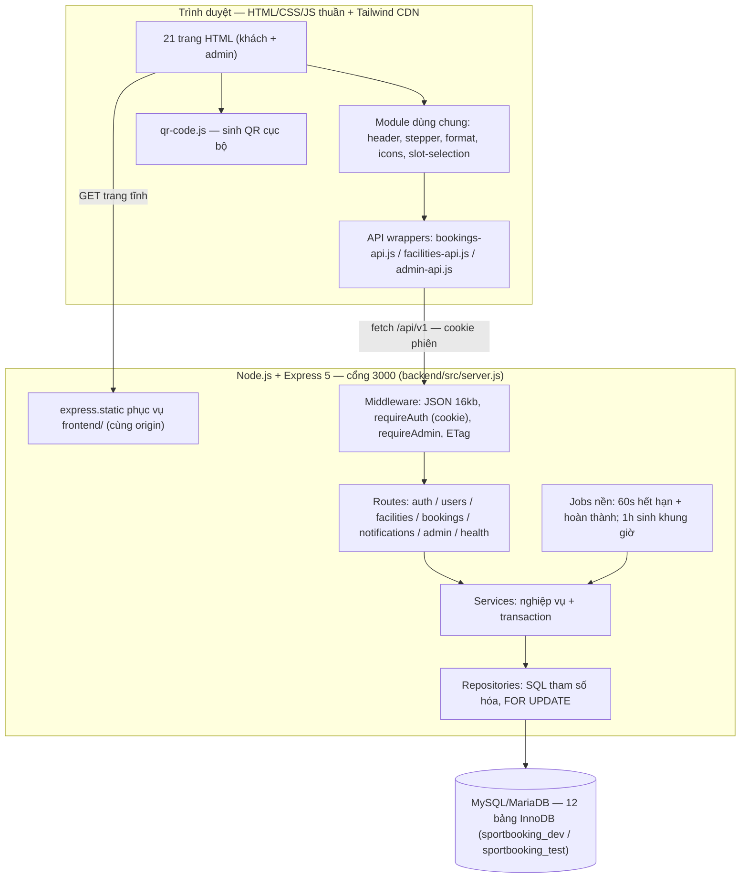

Frontend và backend chạy cùng một tiến trình Express, cùng origin (cổng 3000) nên cookie phiên hoạt động không cần CORS. Không có microservice, không có message queue — jobs nền chạy trong cùng tiến trình bằng `setInterval`.

### 3.3. Sequence diagram — chức năng điển hình: Tạo đơn đặt sân

*Hình 3.2 — Trình tự xử lý POST /api/v1/bookings (rút gọn từ bookings.service.js).*

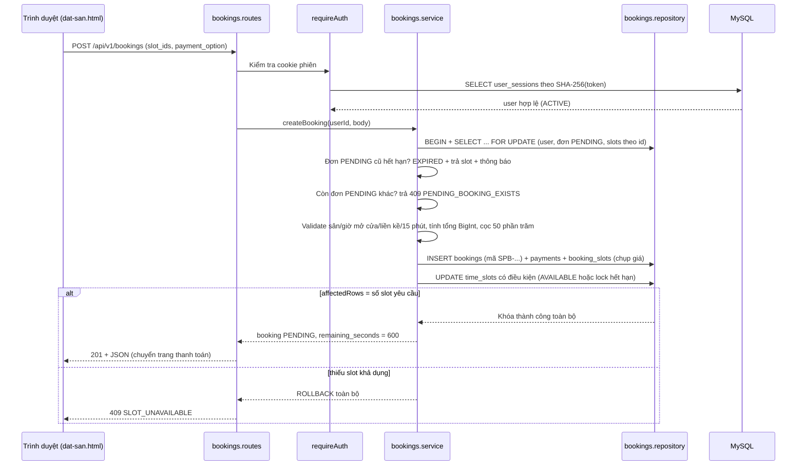

Điểm mấu chốt: khóa nguyên tử tất cả khung giờ bằng UPDATE có điều kiện + kiểm tra `affectedRows`; deadlock/lock timeout được bắt và trả 409 BOOKING_CONFLICT. Không bao giờ giữ chỗ một phần.

### 3.4. DFD mức 1 — luồng dữ liệu chính

*Hình 3.3 — Sơ đồ luồng dữ liệu (DFD mức 1).*

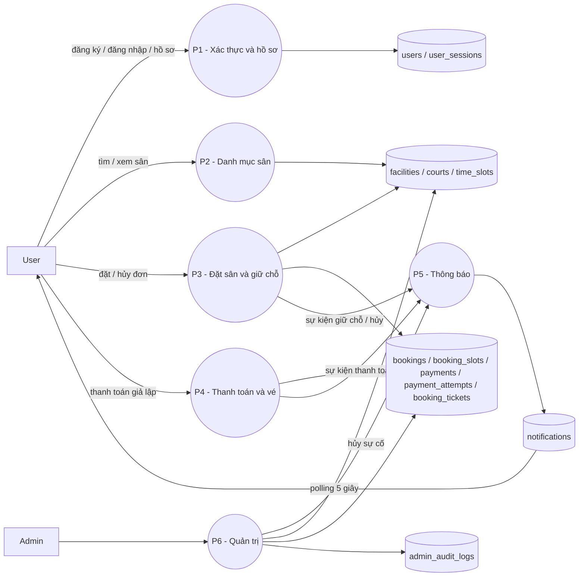

Mọi sự kiện thông báo được ghi cùng transaction với thay đổi nghiệp vụ (`notification-events.js`) — không có độ trễ hàng đợi. Dữ liệu admin GET đi kèm ETag để polling 5s trả 304 khi không đổi.

### 3.5. Lý do chọn kiến trúc

- **Monolith cùng origin — chủ động loại bỏ lỗi CORS:** `app.js` dùng `express.static` phục vụ frontend ngay trong tiến trình API, nên trình duyệt gọi API cùng origin — không phát sinh preflight CORS, không cần cấu hình cross-origin. Một lệnh `npm start` chạy toàn hệ thống, triển khai và sao lưu đơn giản.
- **Bảo mật phiên theo chuẩn cookie:** cookie phiên đặt `httpOnly: true` + `sameSite: 'lax'` (`session.cookie.js`). HttpOnly khiến JavaScript không đọc được cookie (giảm rủi ro XSS đánh cắp phiên); SameSite=Lax chặn gửi cookie theo yêu cầu cross-site (giảm rủi ro CSRF). Cùng origin là điều kiện để bộ đôi này hoạt động đúng mà không cần nới lỏng chính sách.
- **Polling 5s + ETag/304 — tối ưu băng thông, đúng quy mô:** middleware `admin-etag.js` băm SHA-256 payload (loại `server_time` để tránh nhiễu) thành weak ETag; khi `If-None-Match` khớp, server trả 304 không thân — chu kỳ 5s gần như không tốn băng thông lúc dữ liệu đứng yên. Nhịp 5s đủ mịn cho nghiệp vụ đặt sân, không phải duy trì WebSocket/SSE và hạ tầng push phức tạp.
- **Tách routes / service / repository theo miền** (auth, facilities, bookings, notifications, admin) — mỗi tầng test độc lập được, bằng chứng là 325 test đạt (Phần 9).
- **An toàn dữ liệu:** mọi thao tác ghi quan trọng dùng transaction + khóa dòng; quyền kiểm tra ở middleware và trong service (chủ đơn). Job nền chạy trong tiến trình web theo thiết kế idempotent — không cần hàng đợi riêng ở quy mô đồ án.

**Ý chính khi demo**
- Một tiến trình Express phục vụ cả frontend tĩnh lẫn REST API cùng origin → không CORS; cookie HttpOnly + SameSite=Lax bảo vệ phiên.
- Chống đặt trùng bằng transaction + UPDATE có điều kiện (affectedRows) — minh họa bằng Hình 3.2.
- Realtime là polling 5 giây có ETag/304: dữ liệu không đổi thì trả 304 không thân; thông báo ghi cùng transaction sự kiện.

---

## Phần 4 Database

### 4.1. Tổng quan

- 12 bảng InnoDB, charset `utf8mb4_unicode_ci`, khóa chính BIGINT UNSIGNED AUTO_INCREMENT, thời gian DATETIME(3).
- 8 migration idempotent trong `infra/database/migrations/` (001 auth → 008 audit). Runner kiểm tra `information_schema` trước khi áp dụng, từ chối trạng thái áp dụng dở.
- Guard tên DB: chỉ chấp nhận `sportbooking_dev` / `sportbooking_test`; chặn `sportbooking_system`, chặn user `root`.
- Tiền lưu DECIMAL(12,0) (VND, không lẻ); backend tính bằng BigInt để tránh sai số.

### 4.2. Bảng thực thể

| Bảng | Vai trò | PK | FK / ràng buộc chính |
|---|---|---|---|
| users | Tài khoản User/Admin; hồ sơ; đếm lần sai mật khẩu | id | UNIQUE email, phone; role ENUM(USER, ADMIN); account_status ENUM(ACTIVE, ADMIN_LOCKED); failed_login_count, login_locked_until, terms_accepted_at |
| user_sessions | Phiên đăng nhập (chỉ lưu hash của token) | id | FK user_id → users (CASCADE); UNIQUE token_hash (CHAR 64); expires_at, revoked_at |
| facilities | Cơ sở thể thao (29 cơ sở seed) | id | district, opening_time/closing_time, hotline, latitude/longitude, map_url, amenities JSON (CHECK JSON_VALID), is_active, is_seed |
| courts | Sân con thuộc cơ sở | id | FK facility_id → facilities (CASCADE); sport_type ENUM(FOOTBALL_MINI, BADMINTON, PICKLEBALL); price_normal/price_peak; initial_rating CHECK 1.0–5.0; UNIQUE tên trong cơ sở |
| time_slots | Khung giờ theo ngày của sân; trạng thái giữ/đặt | id | FK court_id → courts (CASCADE); UNIQUE(court_id, service_date, starts_at); status AVAILABLE/LOCKED/BOOKED; price; lock_expires_at; current_booking_id |
| bookings | Đơn đặt sân | id | UNIQUE booking_code (SPB-YYYYMMDD-xxxxxx); FK user_id → users (RESTRICT); status ENUM(PENDING, CONFIRMED, CANCELLED, EXPIRED, COMPLETED); total_amount; lock_expires_at; match_preference JSON; cancelled_by/cancellation_reason/cancelled_at |
| booking_slots | Nối đơn ↔ khung giờ; chụp giá tại thời điểm đặt | id | FK booking_id, time_slot_id (RESTRICT); UNIQUE(booking_id, time_slot_id); court_id; price_at_booking |
| payments | Thanh toán của đơn (1–1) | id | FK booking_id UNIQUE (RESTRICT); status ENUM(PENDING, PAID, REFUNDED); amount_due, paid_amount, refunded_amount; payment_option ENUM(DEPOSIT_50, FULL); paid_at, refunded_at |
| payment_attempts | Mọi lần thử thanh toán (kể cả thất bại) | id | FK payment_id; UNIQUE(payment_id, attempt_no); method ENUM(BANK_TRANSFER, MOMO, DOMESTIC_ATM, INTERNATIONAL_CARD); result ENUM(PROCESSING, SUCCEEDED, FAILED); amount |
| booking_tickets | Vé QR — đúng 1 vé/đơn | id | FK booking_id UNIQUE; UNIQUE qr_code (VARCHAR 80) |
| notifications | Thông báo trong app theo user | id | FK user_id → users (CASCADE); category ENUM(BOOKING_HOLD, MATCH, PAYMENT, SYSTEM); title, body, resource_type/resource_id, read_at |
| admin_audit_logs | Nhật ký thao tác admin | id | FK admin_user_id → users; action, resource_type, resource_id, details, created_at |

Bằng chứng: `infra/database/migrations/001…008*.sql`. Không có bảng `reviews` hay `match_requests` → FR-18 và FR-13–15 chưa triển khai ở tầng dữ liệu.

### 4.3. ERD

*Hình 4.1 — ERD 12 bảng (thu gọn thuộc tính chính).*

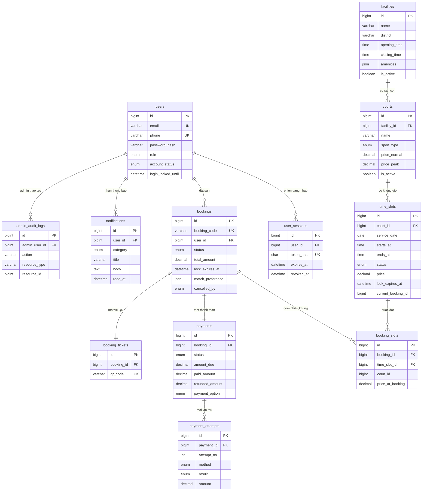

Quan hệ 1–1: bookings ↔ payments ↔ booking_tickets (đều UNIQUE theo `booking_id`). Chuỗi đặt sân dùng FK RESTRICT để không xóa nhầm dữ liệu lịch sử; sessions/notifications/courts/time_slots dùng CASCADE theo cha.

### 4.4. Vòng đời trạng thái

| Đối tượng | Trạng thái | Chuyển trạng thái |
|---|---|---|
| bookings.status | PENDING → CONFIRMED → COMPLETED; nhánh CANCELLED / EXPIRED | PENDING + thanh toán SUCCESS → CONFIRMED; job 60s: PENDING quá lock → EXPIRED, CONFIRMED qua giờ kết thúc → COMPLETED; hủy hợp lệ → CANCELLED. "Sắp tới / Đang trong trận" là trạng thái hiển thị tính động, không lưu DB |
| time_slots.status | AVAILABLE → LOCKED → BOOKED | Tạo đơn: AVAILABLE→LOCKED (+10 phút); thanh toán: LOCKED→BOOKED; hủy/hết hạn: trả về AVAILABLE. LOCK quá hạn được coi là trống ở mọi nơi đọc |
| payments.status | PENDING → PAID → REFUNDED | SUCCESS → PAID (ghi paid_amount); hủy có hoàn → REFUNDED (ghi refunded_amount, kể cả hoàn một phần); hoàn 0đ vẫn giữ PAID |
| payment_attempts.result | PROCESSING / SUCCEEDED / FAILED | API nhận simulation_result SUCCESS/FAILURE, lưu SUCCEEDED/FAILED; mọi lần thử đều giữ để đối soát |

### 4.5. Ba truy vấn then chốt (diễn giải)

Ba truy vấn dưới đây là "xương sống" của nghiệp vụ đặt sân; tất cả đều **tham số hóa** (placeholder `?`, không ghép chuỗi giá trị người dùng) nên chống SQL injection. Alias SQL được validate bằng regex trước khi ghép.

1. **Khóa khung giờ nguyên tử** (`bookings.repository.js` — `lockTimeSlotsForBooking`): một lệnh `UPDATE time_slots` chuyển các khung được chọn sang `LOCKED`, gán `current_booking_id` và `lock_expires_at`, **với điều kiện** khung đang `AVAILABLE` hoặc `LOCKED` nhưng đã hết hạn. Service kiểm tra `affectedRows` phải bằng đúng số slot yêu cầu; thiếu dù chỉ một khung → ROLLBACK toàn bộ và trả 409 SLOT_UNAVAILABLE. Đây là chốt chống đặt trùng: không bao giờ giữ chỗ một phần.
2. **Hạn giữ chỗ lấy từ giờ server** (`createHoldDeadline`): `SELECT DATE_ADD(UTC_TIMESTAMP(3), INTERVAL 10 MINUTE)` — hạn 10 phút tính bằng đồng hồ DB, không tin đồng hồ client.
3. **Điều kiện "khung chọn được" dùng chung mọi lưới giờ** (`facilities/slot-availability.js` — `selectableSlotPredicate`): một khung được chọn khi (a) `AVAILABLE` hoặc `LOCKED` đã hết hạn; (b) sân và cơ sở đều `is_active`; (c) nằm trong giờ mở/đóng cửa; (d) thời điểm bắt đầu ≥ hiện tại (UTC+7) + 15 phút. Dùng chung một predicate nên mọi nơi đọc lịch đều nhất quán "thế nào là trống".

**Ý chính khi demo**
- 12 bảng, trục chính: users → bookings → booking_slots → time_slots; payments/attempts/tickets gắn 1–1 hoặc 1–N theo đơn.
- Chống đặt trùng ở tầng DB: UNIQUE(court_id, service_date, starts_at) + UPDATE có điều kiện + transaction.
- Giá chụp tại thời điểm đặt (`price_at_booking`), tiền DECIMAL(12,0) + BigInt; giờ giấc thống nhất UTC_TIMESTAMP và UTC+7.

---

## Phần 5 Cấu trúc thư mục

Luật dự án (AGENTS.md): root chỉ chứa folder con + AGENTS.md/CLAUDE.md (ngoại lệ .gitignore, .git/, .claude/); tài liệu vào `docs/`; code đúng folder trách nhiệm `frontend/` (UI), `backend/` (API + nghiệp vụ), `infra/` (database, deploy).

### 5.1. Tổng quan cấu trúc (rút gọn)

Bốn folder trách nhiệm chính, tổ chức theo miền (domain) ở cả hai phía:

| Folder | Trách nhiệm | Thành phần chính |
|---|---|---|
| `backend/` | API + logic nghiệp vụ (Node/Express, CommonJS) | `src/app.js` (khung app), `src/server.js` (khởi động + jobs), `src/config/` (pool + guard DB), 5 miền `auth/ facilities/ bookings/ notifications/ admin/`, `routes/health.routes.js`; `tests/` (21 file); `run-tests.js`, `.env.example` |
| `frontend/` | UI thuần HTML/CSS/JS (không build step) | 21 trang `.html`; `shared/` (header, app, format, icons, stepper, slot-selection…); `booking/`, `admin/`, `notifications/`, `profile/` (module miền); `assets/qr-code.js` + ảnh; `tests/` (34 file DOM giả) |
| `infra/` | Database & dữ liệu khởi tạo | `database/migrations/001–008.sql`; script migrate/seed (`migrate-facilities.js`, `migrate-bookings.js`, `seed-facilities.js`, `seed-admin.js`); `facilities-db.js` (allowlist DB); `data/khao-sat-san.xlsx` |
| `docs/` | Toàn bộ tài liệu theo vòng đời | `01-plan/` (phieu-yeu-cau, business-flow), `02-design/` (spec, terms-and-privacy, mockups), `03-build/` (20 plan-*.md), `04-product/` (roadmap, changelog) |

Mỗi miền backend thường có bộ `routes → service → repository` (ví dụ `bookings/` gồm `bookings.routes.js`, `bookings.service.js` ~1044 dòng, `bookings.repository.js`, `cancellation-policy.js`). Frontend tách `*-page.js` (đụng DOM) khỏi `*-state.js` / `*-data.js` (logic thuần, test được không cần trình duyệt).

### 5.2. Phân tích tổ chức thư mục

- **Theo miền ở cả hai phía:** backend có auth/facilities/bookings/notifications/admin; frontend có booking/admin/notifications/profile/shared — dễ tìm code theo tính năng.
- **Tách state thuần khỏi DOM:** các file `*-state.js` không đụng DOM nên test `node:test` chạy được không cần trình duyệt.
- **Tài liệu tập trung ở `docs/` theo vòng đời:** 01-plan → 02-design → 03-build → 04-product; mockup chỉ là tham khảo, không phải code chạy.
- **`infra` tách khỏi backend:** migration/seed là script độc lập, có allowlist DB riêng — backend runtime không tự tạo bảng.

### 5.3. File quan trọng nhất

| File | Vì sao quan trọng |
|---|---|
| `backend/src/app.js` | Toàn bộ cấu hình Express: middleware, mount 7 router, static, error handler — đọc đầu tiên để hiểu backend |
| `backend/src/server.js` | Khởi động + jobs nền (hết hạn/hoàn thành/sinh slot) + graceful shutdown |
| `backend/src/bookings/bookings.service.js` | Trái tim nghiệp vụ: tạo đơn, giữ chỗ, thanh toán, hủy, hoàn tiền (~1044 dòng) |
| `backend/src/bookings/cancellation-policy.js` | Chính sách hoàn 100/50/0% — đáng demo vì thuần và dễ test |
| `backend/src/facilities/slot-availability.js` | Một predicate SQL dùng chung mọi nơi đọc lịch → nhất quán "thế nào là trống" |
| `backend/src/config/database.js` | Guard môi trường + DB, chống chạy nhầm vào DB thật |
| `frontend/shared/app.js` | Luồng auth phía client + cổng đọc điều khoản + redirect returnTo |
| `frontend/booking/bookings-api.js` | Wrapper fetch chuẩn: timeout 15s, 401→login, sự kiện pending-booking-changed |
| `frontend/admin/admin-shell.js` | Khung admin: phân quyền, sidebar, polling 5s có backoff + tạm dừng khi ẩn tab |
| `frontend/assets/qr-code.js` | Sinh QR không cần mạng/dịch vụ ngoài — điểm nhấn kỹ thuật frontend |
| `infra/database/migrations/*.sql` | Nguồn sự thật schema; 8 file idempotent |
| `docs/01-plan/business-flow.md` | Nguồn sự thật nghiệp vụ — mọi tranh luận quay về đây |

**Ý chính khi demo**
- Tổ chức theo miền ở cả backend lẫn frontend; tài liệu bắt buộc nằm trong `docs/`.
- Muốn hiểu luồng đặt sân: đọc `bookings.service.js` + `bookings.repository.js`; muốn hiểu giao diện: bắt đầu từ `shared/app.js` và `bookings-api.js`.
- File `.env` không bao giờ commit (đã kiểm chứng `.gitignore`); chỉ `.env.example` được chia sẻ.

---

## Phần 6 Backend

### 6.1. Framework & khởi động

- Express 5.1, CommonJS, không TypeScript. Factory `createApp({ pool })` nhận pool qua dependency injection → test dựng app với DB test dễ dàng.
- Khởi động (`server.js`): nạp dotenv → validate PORT → tạo pool → `app.listen` → đăng ký jobs: mỗi 60s chạy `releaseExpiredBookings` + `completeDueBookings`; sinh khung giờ lúc khởi động và mỗi giờ nếu `SLOT_GENERATOR_ENABLED` (mặc định chỉ development). SIGINT/SIGTERM đóng pool graceful.
- Middleware toàn cục: `express.json({ limit: '16kb' })`; mount routers; `express.static(frontend, { index: false })`; 404 JSON; error middleware trả `{ error: { code, message, details } }` — lỗi 500 chỉ log stack ở development.
- `GET /` redirect 302 tới `/dang-nhap.html`.

### 6.2. Luồng xử lý một request

*Hình 6.1 — Pipeline xử lý request trong Express app.*

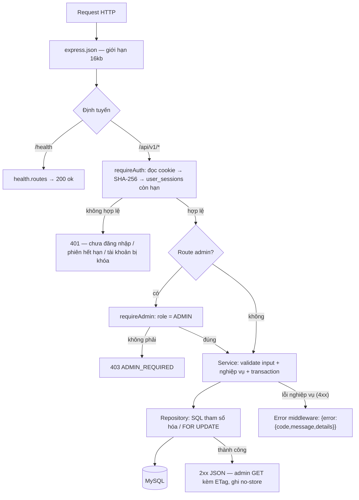

Xác thực dùng cookie phiên `sportbooking_session` (httpOnly, sameSite=lax). Server chỉ lưu SHA-256 của token trong DB — lộ DB không lộ token. Mọi route facilities/bookings/notifications/admin đều yêu cầu đăng nhập; riêng register/login/health công khai.

### 6.3. Các module backend

| Module | Thư mục / file chính | Trách nhiệm |
|---|---|---|
| Auth & hồ sơ | `backend/src/auth/` — auth.service, session.service, session.cookie, password.helper, profile.service, 2 middleware, 2 repository, 2 routes | Đăng ký (bắt buộc termsAccepted), đăng nhập (khóa 5 lần/15 phút), phiên 8h, sửa hồ sơ/đổi mật khẩu |
| Facilities | `backend/src/facilities/` — routes, service, repository, slot-availability, slot-generator | Danh sách/chi tiết/lưới giờ; lọc 14 ngày; sinh khung giờ; giờ vàng |
| Bookings | `backend/src/bookings/` — routes, service (~1044 dòng), repository, cancellation-policy | Tạo đơn giữ chỗ, chống trùng, thanh toán giả lập, vé, hủy/hoàn, jobs hết hạn/hoàn thành |
| Notifications | `backend/src/notifications/` — routes, service, repository, notification-events | Thông báo theo user; ghi sự kiện trong transaction nghiệp vụ |
| Admin | `backend/src/admin/` — routes (23 endpoint), admin.service, facilities.service, slots.service, repository, admin-etag, admin-audit, bookings-export | Users/cơ sở/sân/giá/đơn/dashboard; hủy sự cố; xuất Excel; audit; ETag/304 |
| Health & hạ tầng | `routes/health.routes.js`, `config/database.js`, `app.js`, `server.js` | Health check; pool + guard DB; khung ứng dụng + jobs |

### 6.4. Các nhóm API (46 endpoint — bảng đầy đủ ở Phụ lục A)

Toàn bộ API dưới `/api/v1` (riêng `GET /health` ở gốc). Response lỗi thống nhất `{error:{code,message,details?}}`; phân trang mặc định `page=1`, `page_size≤50`. Chi tiết từng endpoint: Phụ lục A — mục 12.1.

| Nhóm API | Số lượng | Endpoint tiêu biểu | Quyền |
|---|---|---|---|
| Auth | 4 | POST /auth/register · POST /auth/login · GET /auth/me | Công khai (register/login); Đăng nhập (logout/me) |
| Hồ sơ | 2 | PATCH /users/me · PATCH /users/me/password | Đăng nhập |
| Cơ sở & khung giờ | 3 | GET /facilities · GET /facilities/:id · GET /courts/:id/time-slots | Đăng nhập |
| Đặt sân & thanh toán | 9 | POST /bookings · POST /bookings/:id/payment-attempts · POST /bookings/:id/cancel · GET /bookings/:id/refund-preview | Đăng nhập / Chủ đơn |
| Thông báo | 4 | GET /notifications/unread-count · POST /notifications/read-all · PATCH /notifications/:id/read | Đăng nhập / Chủ sở hữu |
| Admin | 23 | GET /admin/dashboard · PATCH /admin/users/:id/lock · POST /admin/bookings/:id/incident-cancellation · 5 endpoint xuất Excel | Admin (requireAuth + requireAdmin) |
| Health | 1 | GET /health | Công khai |

Quy ước chung: GET admin kèm ETag/304, thao tác ghi đặt `no-store`; xuất Excel giới hạn 5000 dòng, chống formula injection và ghi audit; mọi thao tác ghi admin vào `admin_audit_logs` trong cùng transaction.

### 6.5. Ví dụ Request / Response (diễn giải)

Cấu trúc các ví dụ được đối chiếu từng trường với mã nguồn (`bookings.service.js`, `auth.service.js`); giá trị id/tiền mang tính minh họa.

**Tạo đơn thành công — `POST /api/v1/bookings` → 201.** Request gửi `slot_ids` (mảng id khung), `payment_option` (`DEPOSIT_50` hoặc `FULL`), `match_preference` (tùy chọn). Response trả về các trường chính:

| Trường | Ý nghĩa | Ví dụ |
|---|---|---|
| booking_id / booking_code | Định danh đơn + mã hiển thị | "57" / "SPB-20261115-A7K2M9" |
| status | Trạng thái đơn | "PENDING" |
| total_amount | Tổng tiền (VND, chuỗi số) | "240000" |
| payment | Trạng thái thanh toán + phương án + số phải trả | { status: "PENDING", payment_option: "DEPOSIT_50", amount_due: "120000" } |
| deposit_amount / amount_due_at_venue | Cọc đã trả / phần còn lại thu tại sân | "120000" / "120000" |
| lock_expires_at / remaining_seconds | Hạn giữ chỗ (ISO) / giây còn lại | "2026-11-15T09:10:00.000Z" / 600 |
| slots | Chi tiết từng khung giờ | [ … ] |

**Đang có đơn giữ chỗ — `POST /api/v1/bookings` → 409.** Trả `error.code = PENDING_BOOKING_EXISTS`, message "Bạn đang có một đơn đặt sân còn hiệu lực.", kèm `details.pending_booking_id` và `details.remaining_seconds` để frontend mở lựa chọn tiếp tục/hủy đơn cũ.

**Đăng ký — `POST /api/v1/auth/register` → 201 `{user}`.** Request gồm `fullName, email, phone, password (8–72 byte), termsAccepted=true`. Response chỉ trả **trường công khai** (id, fullName, email, phone, gender, skillLevel, role) — **không bao giờ trả `password_hash`**.

### 6.6. Mã lỗi nghiệp vụ chính

| HTTP | Code | Ý nghĩa | Nơi phát sinh |
|---|---|---|---|
| 400 | INVALID_SLOT_IDS / INVALID_PAYMENT_OPTION / INVALID_MATCH_PREFERENCE / INVALID_PAYMENT_ATTEMPT | Input đặt sân/thanh toán không hợp lệ | bookings.service.js |
| 400 / 413 | INVALID_JSON / PAYLOAD_TOO_LARGE | Body sai JSON / quá 16kb | app.js (error middleware) |
| 401 | INVALID_CREDENTIALS / ACCOUNT_LOCKED (ở các request sau đăng nhập) | Sai email/mật khẩu / tài khoản bị khóa (require-auth chặn phiên đang dùng) | auth.service.js (login), require-auth.js |
| 423 | LOGIN_TEMPORARILY_LOCKED | Sai 5 lần, khóa tạm 15 phút | auth.service.js |
| 403 | ADMIN_REQUIRED / BOOKING_NOT_OWNED / ACCOUNT_LOCKED (khi đăng nhập) | Không phải admin / không phải chủ đơn / tài khoản bị khóa từ chối đăng nhập | require-admin.js, bookings.service.js, auth.service.js |
| 404 | FACILITY_NOT_FOUND / NOT_FOUND | Không tìm thấy tài nguyên (hoặc không đủ điều kiện công khai) | facilities.service.js, routes |
| 409 | ACCOUNT_CONFLICT | Trùng email/SĐT | auth.service.js |
| 409 | PENDING_BOOKING_EXISTS | Đã có đơn giữ chỗ (kèm pending_booking_id, remaining_seconds) | bookings.service.js |
| 409 | SLOT_UNAVAILABLE / SLOT_TOO_SOON / SLOTS_NOT_CONTIGUOUS / COURT_INACTIVE / SLOT_OUTSIDE_OPENING_HOURS | Khung giờ không đặt được | bookings.service.js |
| 409 | BOOKING_CONFLICT | Deadlock/lock timeout — xung đột đồng thời | bookings.service.js (bắt ER_LOCK_DEADLOCK) |
| 409 | BOOKING_NOT_CANCELLABLE / BOOKING_EXPIRED / PAYMENT_STATE_INVALID / REFUND_PREVIEW_CHANGED | Hủy không hợp lệ / đơn hết hạn khi hủy hoặc xem trước hoàn / lệch mức hoàn đã xem trước | bookings.service.js |
| 410 | BOOKING_EXPIRED | Hết hạn giữ chỗ khi thanh toán | bookings.service.js |
| 409 | ADMIN_SELF_LOCK / USER_STATUS_CONFLICT / FACILITY_HAS_BOOKING_HISTORY / ADMIN_STALE_DATA | Ràng buộc phía admin (khóa lạc quan: expected_updated_at lệch → ADMIN_STALE_DATA) | admin.service.js, admin/facilities.service.js, admin/slots.service.js |
| 400 | EXPORT_TOO_MANY_ROWS | Xuất Excel vượt 5000 dòng | admin.service.js |
| 500 | INTERNAL_ERROR | Lỗi không lường trước (stack chỉ log ở development) | app.js |

**Lưu ý phân biệt cùng mã khác HTTP:**
- `BOOKING_EXPIRED`: **409** khi hủy/xem trước hoàn (`bookings.service.js:762, 886`; cả hủy sự cố phía admin `admin.service.js:659`) và **410** khi thanh toán (`bookings.service.js:973`).
- `ACCOUNT_LOCKED`: **403** khi đăng nhập (`auth.service.js:171–176`), **401** ở các request sau (`require-auth.js:35, 40`).

### 6.7. Điểm kỹ thuật đáng chú ý

- **Transaction + khóa dòng:** mọi thao tác ghi đơn (tạo/hủy/thanh toán/hủy sự cố) chạy trong transaction, khóa user/booking/payment/slots bằng `SELECT ... FOR UPDATE` theo thứ tự id cố định để giảm deadlock.
- **Tiền BigInt:** tổng đơn = tổng giá từng khung; cọc 50% làm tròn lên `(total + 1n) / 2n`; hoàn 50% làm tròn xuống `paid / 2n`.
- **Mã đơn:** `SPB-YYYYMMDD-xxxxxx` sinh từ `crypto.randomBytes`, alphabet bỏ ký tự dễ nhầm, thử lại tối đa 5 lần nếu trùng.
- **ETag admin:** sha256 JSON response (trừ `server_time`) → `If-None-Match` trả 304, giảm tải polling 5s.
- **Audit:** mọi thao tác ghi admin ghi `admin_audit_logs` trong cùng transaction; xuất Excel cũng bị audit.
- **Xuất Excel an toàn:** ô bắt đầu bằng `= + - @` được thêm dấu nháy đơn chống formula injection; giới hạn 5000 dòng.

**Ý chính khi demo**
- 46 endpoint chia 6 miền; quyền kiểm tra 2 lớp middleware (requireAuth, requireAdmin) + kiểm tra chủ đơn trong service.
- Điểm nhấn: transaction chống đặt trùng, BigInt cho tiền, ETag/304 cho polling, audit cùng transaction.
- Mọi lỗi đều có code nghiệp vụ rõ ràng (409/410/423…) để frontend xử lý đúng ngữ cảnh.

---

## Phần 7 Frontend

### 7.1. Công nghệ & tổ chức

- HTML/CSS/JS thuần, không framework (không React/Vue), không build step; Tailwind CSS qua CDN + design token trong `frontend/app.css`; font Be Vietnam Pro/Inter (Google Fonts).
- File được Express phục vụ cùng origin với API → fetch dùng `credentials: 'same-origin'`, cookie phiên tự gửi kèm.
- Module dùng chung gắn biến toàn cục `window.SportBooking*` theo mẫu UMD (vừa chạy trình duyệt vừa `require` được trong node:test).
- Tách state thuần (`*-state.js`, `*-data.js`) khỏi phần đụng DOM → 34 file test chạy không cần trình duyệt.

### 7.2. Bảng trang (21 trang HTML)

| Trang | Chức năng | Script chính | API sử dụng |
|---|---|---|---|
| dang-nhap.html | Đăng nhập email + mật khẩu | shared/app.js | POST /auth/login |
| dang-ky.html | Đăng ký + cổng đọc điều khoản | shared/app.js | POST /auth/register |
| trangchu-user.html | Trang chủ khách: sân nổi bật, lối vào chức năng | trangchu-user.js, shared/header.js | GET /facilities |
| tim-san.html | Tìm sân: lọc môn/quận/ngày/khung giờ | tim-san.js, shared/search-filters.js | GET /facilities |
| chi-tiet-san.html | Chi tiết sân + lưới chọn khung giờ (poll 5s) | chi-tiet-san.js, shared/slot-selection.js | GET /facilities/:id, /courts/:id/time-slots |
| dat-san.html | Bước 1: xác nhận đơn, chọn cọc/toàn bộ | booking/booking-page.js, shared/stepper.js | POST /bookings |
| thanh-toan.html | Bước 2: thanh toán giả lập, countdown, QR chuyển khoản | booking/payment-page.js, payment-data.js | GET /bookings/:id, /payments; POST payment-attempts |
| dat-san-thanh-cong.html | Bước 3: hoàn tất, dẫn tới vé | booking/booking-complete-page.js | GET /bookings/:id |
| ve-dien-tu.html | Vé điện tử: QR cục bộ + thông tin đơn | booking/ticket-page.js, ticket-data.js, assets/qr-code.js | GET /bookings/:id, /facilities/:id, /auth/me |
| lich-su-dat-san.html | Lịch sử + tóm tắt + lọc/tìm kiếm (poll 5s) | booking/booking-history-page.js + state | GET /bookings?mine=true, /summary, /pending |
| chi-tiet-don-dat-san.html | Chi tiết đơn: trạng thái động, hủy, tiếp tục thanh toán (poll 5s) | booking/booking-detail-page.js + state, cancellation-dialog.js | GET /bookings/:id, /refund-preview; POST cancel |
| thong-bao.html | Thông báo: tab loại, đánh dấu đọc | notifications/notifications-page.js + state | GET /notifications, POST read-all, PATCH :id/read |
| profile/profile.html | Hồ sơ: sửa thông tin, đổi mật khẩu | profile/profile-view.js, shared/app.js | PATCH /users/me, /me/password |
| quan-tri-tong-quan.html | Dashboard admin: KPI, biểu đồ (poll 5s + ETag) | admin/dashboard-page.js + state, admin-shell.js | GET /admin/dashboard, /dashboard/export |
| quan-tri.html | Quản lý đơn: lọc, popup chi tiết, hủy sự cố, export | admin/admin-page.js, incident-cancel-dialog.js | GET /admin/bookings, /:id; POST incident-cancellation |
| quan-tri-nguoi-dung.html | Quản lý user: khóa/mở, thống kê, export | admin/users-page.js | GET /admin/users; PATCH lock/unlock |
| quan-tri-san.html | Quản lý cơ sở & sân: CRUD, khóa/mở, export | admin/facilities-page.js + state | /admin/facilities, /admin/courts |
| quan-tri-khung-gio-gia.html | Khung giờ & giá: xem tuần/tháng, sinh slot, sửa giá | admin/slots-page.js + state | /admin/time-slots, generate-slots, prices |
| admin-bookings.html | Trang quản lý đơn thế hệ cũ — không nằm trong sidebar admin hiện tại | booking/admin-page.js | /admin/bookings |
| auth/login.html | Trang đăng nhập cũ theo mockup — luồng hiện tại dùng dang-nhap.html | — | — |
| auth/register.html | Trang đăng ký cũ theo mockup — luồng hiện tại dùng dang-ky.html | — | — |

Bằng chứng: grep `<script src=` từng trang; điều hướng admin trong `admin-shell.js` (5 mục); redirect đăng nhập trong `shared/app.js` và `booking/admin-state.js` (USER_HOME=/trangchu-user.html, ADMIN_HOME=/quan-tri-tong-quan.html).

### 7.3. Module dùng chung

| Module | Vai trò |
|---|---|
| shared/app.js | Form đăng nhập/đăng ký/hồ sơ; validate phía client; cổng đọc pháp lý (chỉ bật ô đồng ý khi mở VÀ cuộn hết cả 2 văn bản); redirect login kèm returnTo; thông báo query (locked/registered…) |
| shared/header.js + header-state.js | Header khách: chuông thông báo + thanh giữ chỗ PENDING (countdown, tiếp tục/hủy); poll 5s; ẩn banner trên trang thanh toán/auth/admin |
| shared/footer.js + support-constants.js | Footer chung + hotline nền tảng 1900 8899. Liên kết "Điều khoản sử dụng" / "Chính sách bảo mật" hiện là span disabled "Sắp có" — chưa có trang pháp lý công khai riêng theo business-flow §3/§8 |
| shared/format.js | formatBookingCode, maskPhone, định dạng tiền/ngày |
| shared/icons.js | Icon SVG nội bộ — không phụ thuộc font Material Symbols bên ngoài |
| shared/stepper.js | Thanh bước 1→2→3 dùng chung; bước 1 chỉ quay lại được khi lock còn hạn |
| shared/slot-selection.js | Chọn khung giờ liền kề: click khung đã chọn để cắt bớt; chỉ nhận khung kề đầu/cuối dãy |
| shared/search-filters.js, back-nav.js | Bộ lọc tìm sân; điều hướng quay lại an toàn |
| booking/bookings-api.js | Wrapper fetch miền đơn: timeout 15s (AbortController), 401→login/locked, phát sự kiện pending-booking-changed sau create/cancel/SUCCESS |
| shared/facilities-api.js, admin/admin-api.js | Wrapper API danh mục sân / admin (no-store, chuẩn hóa lỗi) |
| admin/admin-shell.js | authorizeAdmin (getMe, timeout 10s, 401→login, không phải ADMIN→trang chủ); sidebar 5 mục; startPolling 5s: tạm dừng khi ẩn tab, AbortController, backoff 10/20/30s |
| assets/qr-code.js | Sinh QR cục bộ: version 15 (77×77), Reed–Solomon, byte mode, kiểm tra sức chứa payload |

### 7.4. Quản lý trạng thái & kết nối API

- Không store toàn cục kiểu Redux: trạng thái nằm trong module trang + các khối state thuần; **server là nguồn sự thật** — sau mỗi thay đổi (hủy, thanh toán) trang đọc lại từ API rồi render.
- Đồng bộ giữa các trang: sự kiện cửa sổ `pending-booking-changed` giúp header cập nhật thanh giữ chỗ ngay sau create/cancel/thanh toán, không chờ poll.
- Fetch chuẩn: `credentials: 'same-origin'`; lỗi được chuẩn hóa `{status, code, message}`; 401 → redirect `/dang-nhap.html?returnTo=…`; timeout 15s cho API đơn.
- Countdown phía client chỉ để hiển thị: quyết định hết hạn luôn theo server (`remaining_seconds`, 410 BOOKING_EXPIRED) — không tin đồng hồ client.

### 7.5. Luồng tương tác: gọi backend vs thuần frontend

| Luồng | Loại | Mô tả |
|---|---|---|
| Đăng nhập/đăng ký/đổi mật khẩu | Gọi backend | POST/PATCH auth, users; validate client chỉ hỗ trợ, server quyết định |
| Chọn khung giờ liền kề | Thuần frontend | slot-selection.js kiểm tra kề nhau tức thì; server vẫn validate lại khi tạo đơn (SLOTS_NOT_CONTIGUOUS) |
| Tạo đơn / thanh toán / hủy | Gọi backend | POST bookings, payment-attempts, cancel; xử lý 409/410/401 theo code |
| Countdown giữ chỗ, stepper, popup | Thuần frontend (hiển thị) | payment-page.js đếm ngược 250ms từ remaining_seconds; stepper khóa bước khi hết hạn |
| Cổng đọc điều khoản | Thuần frontend | bindLegalReadGate: theo dõi mở + cuộn hết 2 văn bản mới bật checkbox; server vẫn bắt buộc termsAccepted=true |
| Vẽ QR vé / QR chuyển khoản | Thuần frontend | qr-code.js sinh SVG từ payload văn bản; không gọi dịch vụ QR ngoài |
| Lưới giờ, lịch sử, chuông, admin | Gọi backend (poll 5s) | chi-tiet-san, booking-history, header, 5 trang admin; admin GET dùng ETag/304 |
| Lọc/tìm kiếm phía client | Hỗn hợp | Bộ lọc gọi API với query; một số tinh chỉnh hiển thị làm ở client |

### 7.6. Sơ đồ component frontend

*Hình 7.1 — Quan hệ trang → module dùng chung → API wrapper → backend.*

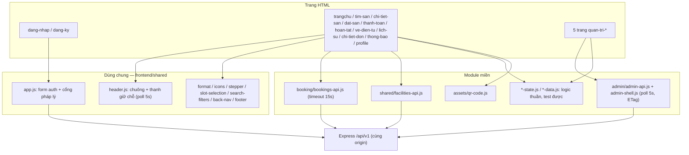

Mọi trang admin đi qua admin-shell (phân quyền + polling); mọi trang khách dùng header chung. Logic nghiệp vụ hiển thị nằm trong `*-state`/`*-data` để test độc lập; DOM chỉ được đụng ở `*-page.js`.

**Ý chính khi demo**
- Không framework: HTML/JS thuần + Tailwind CDN; module UMD gắn `window.SportBooking*` để vừa chạy web vừa test Node.
- Server là nguồn sự thật: countdown chỉ hiển thị, hết hạn/hủy/thanh toán đều quyết định bởi API; poll 5 giây + sự kiện tức thời.
- Hai chi tiết đáng khoe: QR sinh cục bộ (không cần mạng) và cổng "đọc hết điều khoản mới được đồng ý".

---

## Phần 8 Module & tiến độ

### 8.1. Nguyên tắc đánh giá trạng thái

Trạng thái module xác định bằng **ba bằng chứng độc lập**: mã nguồn hiện hữu trong backend/ + frontend/, bộ test tự động liên quan đạt 100% (kết quả chạy thật ở Phần 9), và đối chiếu schema trong 8 migration. Module đáp ứng cả ba → **COMPLETED** (Đã hoàn thiện & kiểm thử). Module thuộc phạm vi mở rộng, không có bảng lẫn API tương ứng → **NOT STARTED** (chưa triển khai trong schema & API).

### 8.2. Bảng trạng thái 14 module

| # | Module | FR | Trạng thái | Bằng chứng (code + test) |
|---|---|---|---|---|
| 1 | Đăng ký, đăng nhập, phân quyền, hồ sơ | FR-01, FR-03 | COMPLETED | auth.integration + auth-step5 đạt (khóa 15 phút, phiên 8h, bcrypt 12 vòng); trang dang-nhap/dang-ky/profile đầy đủ. Chưa có trang Điều khoản/Chính sách riêng: footer hiển thị span "Sắp có", văn bản pháp lý nhúng trong dang-ky.html; roadmap: chờ xác nhận trình duyệt |
| 2 | Seed 29 sân, API sân, trang chủ, tìm sân | FR-04, FR-05 | COMPLETED | facilities-seed + facilities.integration đạt; lọc 14 ngày, chỉ cơ sở đủ điều kiện; trang chủ/tìm sân nối API |
| 3 | Admin quản lý cơ sở, sân, khung giờ, giá | FR-04 | COMPLETED | admin-facility-lifecycle + admin.integration đạt (xóa an toàn, audit cùng transaction, đồng bộ khung giờ) |
| 4 | Đặt sân, giữ chỗ 10 phút, chống đặt trùng | FR-06, FR-12 | COMPLETED | bookings.integration đạt (trùng giờ, rollback, 1 PENDING, concurrent hold); SELECT FOR UPDATE trong bookings.repository.js |
| 5 | Thanh toán giả lập, vé QR | FR-07 | COMPLETED | payments.integration đạt (SUCCESS/FAILURE/410/đồng thời); QR cục bộ frontend/assets/qr-code.js |
| 6 | Hủy và hoàn tiền | FR-08 | COMPLETED | cancellation.integration + cancellation-policy đạt (3 mức hoàn 100/50/0%, ngưỡng 24h/6h, 409) |
| 7 | Lịch sử đặt sân | FR-09 | COMPLETED | Test đạt; trạng thái hiển thị động theo UTC+7 (booking-status.test.js); lọc/tìm kiếm đầy đủ |
| 8 | Thông báo trong app | FR-17 | COMPLETED | notifications tests đạt; sự kiện ghi trong transaction nghiệp vụ; 4 phân loại BOOKING_HOLD/MATCH/PAYMENT/SYSTEM |
| 9 | Đánh giá sân | FR-18 | NOT STARTED | Phạm vi mở rộng — không có bảng reviews trong 8 migration; không có API đánh giá |
| 10 | Admin: dashboard, user, booking ngoại lệ | FR-10, FR-11, FR-19 | COMPLETED | admin.integration đạt (403 mọi route, audit, export ≤5000 dòng chống formula injection, hủy sự cố hoàn 100%) |
| 11 | Tìm đối, ghép, nới lỏng | FR-13–15 | NOT STARTED | Phạm vi mở rộng — không có bảng match_requests; dashboard hardcode pending_match_requests: 0; chỉ lưu match_preference khi đặt |
| 12 | Realtime (polling 5 giây) | FR-16 | COMPLETED | Poll dữ liệu 5s ở: header — chuông + banner giữ chỗ (`shared/header.js`, dừng khi tab ẩn); lưới slot (`chi-tiet-san.js`); lịch sử (`booking-history-page.js`); chi tiết đơn (`booking-detail-page.js`); trang đặt (`booking-page.js`); 5 trang admin qua `admin-shell.js` (mặc định 5000ms, lùi 10/20/30s khi lỗi); ETag/304. **Không poll dữ liệu** (chủ đích — nội dung tĩnh hoặc chỉ đếm ngược): trangchu-user, tim-san, notifications-page (danh sách; chuông vẫn poll qua header), ticket-page, booking-complete-page, profile-view, payment-page (chỉ đếm ngược 250ms). Ghép đối chưa làm (chờ module 11). Roadmap: Đang làm — chưa xác nhận bằng trình duyệt |
| 13 | Hotline và trạng thái vé điện tử | FR-07, FR-09 | COMPLETED | Hotline qua SportBookingConstants + footer; vé đối chiếu booking_tickets/payment_status; "VÉ ĐÃ VÔ HIỆU" khi hủy/hoàn |
| 14 | Quên mật khẩu, tin tức RSS, email | — | NOT STARTED | Phạm vi mở rộng — không có route/UI tương ứng; business-flow xếp nhóm tùy chọn làm sau cùng |

### 8.3. Trực quan hóa trạng thái

- **COMPLETED: 11/14** — gồm **10 module cốt lõi và 1 module nâng cao (realtime)**.
- **NOT STARTED: 3/14** — phạm vi mở rộng, chưa triển khai trong schema & API.
- 
### 8.4. Sơ đồ phụ thuộc module

*Hình 8.1 — Kiến trúc module và phụ thuộc chính.*

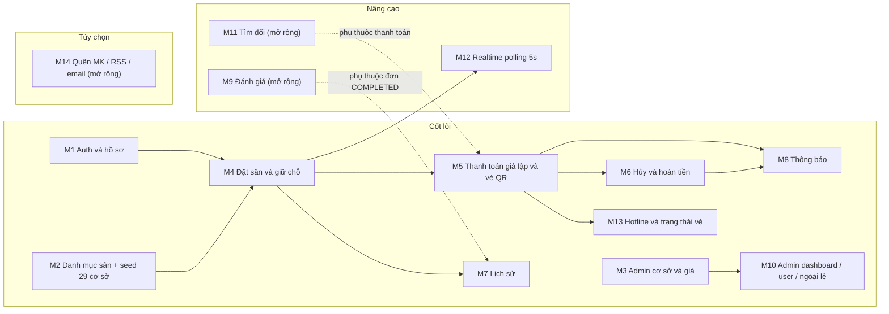

Mọi module cốt lõi đều quy về trục Auth → Đặt sân → Thanh toán. Thông báo (M8) là hạ tầng chung được M4/M5/M6/M10 sử dụng. Module phạm vi mở rộng nối nét đứt.

**Ý chính khi demo**
- 11/14 module COMPLETED — 10 cốt lõi + 1 nâng cao (realtime), 325/325 test tự động đạt.
- 3 module NOT STARTED là phạm vi mở rộng có chủ đích (tìm đối, đánh giá, quên MK/RSS/email), chứng minh bằng schema (không bảng) và API (không route).
- Xác nhận thủ công trên trình duyệt: module 7/8/10 đã xác nhận 15/11/2026; module 1/3/4/5/6/12 còn "chờ người dùng xác nhận" theo roadmap.

---

## Phần 9 Testing & QA

### 9.1. Kết quả chạy test THẬT 

| Bộ test | Lệnh đã chạy | Total | Passed | Failed | Skipped | Thời gian |
|---|---|---|---|---|---|---|
| Backend (21 file) | `cd backend && npm test` → run-tests.js ép APP_ENV=test, DB_NAME=sportbooking_test, node --test --test-concurrency=1 | 102 | 102 | 0 | 0 | ~41,2s |
| Frontend (34 file) | `cd frontend && APP_ENV=test DB_NAME=sportbooking_test node --test --test-concurrency=1 tests/*.test.js` | 237 | 237 | 0 | 0 | ~5,8s |
| **Tổng** | — | **339** | **339** | **0** | **0** | — |

### 9.2. Các loại test đang có

| Loại | Phạm vi | Ví dụ file |
|---|---|---|
| Unit thuần (backend) | Chính sách hoàn tiền, trạng thái hiển thị, bcrypt, cấu hình slot generator | cancellation-policy.test.js, booking-status.test.js, auth-step5.test.js, slot-generator.test.js |
| HTTP integration (backend) | Dựng createApp({pool test}) + fetch thật vào DB test: auth, đặt sân, thanh toán, hủy, admin, thông báo | bookings.integration.test.js, payments.integration.test.js, admin.integration.test.js… |
| Frontend logic (DOM giả) | State/data thuần + trang với DOM tối thiểu: chọn giờ, vé, hủy, polling admin, stepper, format | slot-selection.test.js, ticket-data.test.js, admin-booking-polling.test.js… |
| HTTP integration (frontend) | Luồng create→pay→cancel→rebook qua HTTP thật trên DB test | booking-cancellation-http.test.js |
| Quy ước source | UTF-8 không BOM/ký tự thay thế; đối chiếu mockup (class/bố cục) | source-encoding.test.js, booking-mockup-fidelity.test.js, shared-fonts.test.js |
| Kiểm thử thủ công trên trình duyệt | Chạy trực tiếp với API thật. **Đã thực hiện và được người dùng xác nhận cho module 7/8/10 ngày 15/11/2026** (ghi trong roadmap). Module 1/3/4/5/6/12: chưa xác nhận bằng trình duyệt — roadmap ghi "Chờ người dùng xác nhận". Module 2/13: roadmap ghi "Xong", không ghi nhận kiểm tra trình duyệt | docs/04-product/roadmap.md |

Phạm vi kiểm thử của đồ án: unit + HTTP integration + quy ước source. E2E trình duyệt tự động (Playwright/Cypress), test tải và CI pipeline nằm ngoài phạm vi.

### 9.3. Quy trình kiểm thử của dự án

*Hình 9.1 — Workflow kiểm thử (đối chiếu run-tests.js và guard DB).*

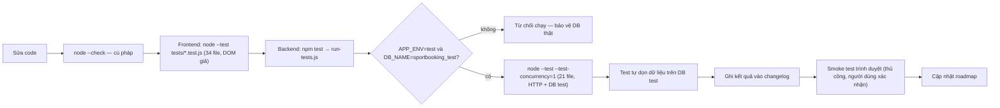

Hai lớp guard (run-tests.js + config/database.js) khiến việc chạy nhầm vào DB thật gần như không thể xảy ra từ đường test. Test chạy tuần tự (`--test-concurrency=1`) để tránh tranh chấp dữ liệu trên cùng DB test.

### 9.4. Bảng test case tiêu biểu (kết quả thật)

Tên kịch bản lấy từ chính các test đã chạy; PASSED = đạt trong lần chạy 15/11/2026.

| # | Kịch bản | Nguồn test | Kết quả |
|---|---|---|---|
| 1 | Đặt 1 khung và nhiều khung liền kề, giá lấy từ server | bookings.integration | PASSED |
| 2 | Từ chối đơn PENDING thứ hai, khung không liền kề, khung <15 phút | bookings.integration | PASSED |
| 3 | Hai người cùng đặt một khung: chỉ một hold thành công | bookings.integration | PASSED |
| 4 | Lỗi tạo payment → rollback toàn bộ đơn và slot | bookings.integration | PASSED |
| 5 | 3 mức hoàn 100/50/0% cho cọc và trả đủ; ngưỡng đúng 24h/6h UTC+7; 50% làm tròn xuống | cancellation.integration + cancellation-policy | PASSED |
| 6 | Đơn đang trong trận/đã kết thúc/hết hạn bị từ chối hủy (409) | cancellation.integration | PASSED |
| 7 | SUCCESS xác nhận nguyên tử payment + đơn + slots + đúng 1 vé; lặp lại → 409 | payments.integration | PASSED |
| 8 | FAILURE giữ nguyên hold, thử lại được; hết hạn → 410 + trả slot, không ghi attempt | payments.integration | PASSED |
| 9 | Hai lệnh SUCCESS đồng thời → chỉ 1 attempt + 1 vé | payments.integration | PASSED |
| 10 | Sai mật khẩu 5 lần → khóa 15 phút; đăng nhập đúng reset bộ đếm; khóa admin độc lập | auth-step5 | PASSED |
| 11 | Phiên 8h lưu hash; đổi hồ sơ/mật khẩu; register chỉ trả public user | auth.integration + auth-step5 | PASSED |
| 12 | User thường gọi mọi route admin → 403, dữ liệu không đổi | admin.integration | PASSED |
| 13 | Xuất Excel: phân quyền, lọc, escape formula, chặn >5000 dòng, audit | admin.integration | PASSED |
| 14 | Hủy sự cố đơn đang trong trận: hoàn 100%, đúng 1 lần; lỗi thông báo → rollback hủy | admin.integration | PASSED |
| 15 | Sinh khung giờ idempotent, không đổi slot đã giữ/đặt; cập nhật giá chỉ slot AVAILABLE | slot-generator.integration + admin.integration | PASSED |
| 16 | Trạng thái hiển thị Sắp tới/Đang trong trận theo biên nửa mở UTC+7; job COMPLETED idempotent | booking-status.test.js | PASSED |
| 17 | Chọn giờ liền kề: kề đầu/cuối, cắt dãy, từ chối không kề (frontend) | frontend/tests/slot-selection.test.js | PASSED |
| 18 | Payload QR vé + QR chuyển khoản đúng định dạng (frontend) | frontend/tests/ticket-data.test.js, payment-data.test.js | PASSED |
| 19 | Polling admin giữ hàng cũ khi đang tải, khôi phục scroll, highlight hàng mới 5s | frontend/tests/admin-booking-polling.test.js | PASSED |
| 20 | HTTP end-to-end: tạo → thanh toán → hủy → lịch trống → đặt lại | frontend/tests/booking-cancellation-http.test.js (cần env test) | PASSED |

### 9.5. Ma trận kiểm thử theo tính năng

| Tính năng | Unit BE | HTTP integration BE | Frontend node:test | Trạng thái |
|---|---|---|---|---|
| Auth & hồ sơ | Có | Có | Có | COMPLETED |
| Danh mục sân / tìm kiếm | Có | Có | Có | COMPLETED |
| Đặt sân / giữ chỗ | Có | Có | Có | COMPLETED |
| Thanh toán / vé QR | Có | Có | Có | COMPLETED |
| Hủy / hoàn tiền | Có | Có | Có | COMPLETED |
| Lịch sử | — | Có | Có | COMPLETED |
| Thông báo | Có | Có | Có | COMPLETED |
| Admin (dashboard/user/cơ sở/export) | Có | Có | Có | COMPLETED |
| Tìm đối / đánh giá | — | — | — | NOT STARTED (mở rộng) |

### 9.6. Đánh giá chất lượng

- **Điểm mạnh:** phủ đủ kịch bản khó (đồng thời, rollback, hết hạn, phân quyền, làm tròn tiền); guard DB nhiều lớp; test frontend không cần trình duyệt nên chạy nhanh (~5s); có test quy ước encoding/mockup.
- **Phạm vi kiểm thử:** unit + HTTP integration trên DB test phủ toàn bộ luồng nghiệp vụ; E2E trình duyệt tự động và test tải nằm ngoài phạm vi đồ án.
- **Rủi ro thấp nhờ thiết kế:** tiền dùng BigInt + DECIMAL, quyền kiểm tra server-side, transaction nhất quán — các lỗi nghiêm trọng nhất đã có test chặn.

### 9.7. Khoảng cách đã biết giữa mockup/tài liệu và code (ghi nhận 15/11/2026 — CHƯA sửa code)

Soát xét toàn bộ trang khách + trang admin ngày 15/11/2026. Đây là khoảng cách nội dung/mockup, không phải lỗi nghiệp vụ backend; liệt kê để trả lời trung thực khi bảo vệ. Đợt này chỉ sửa tài liệu, không sửa code.

| # | Khoảng cách | Bằng chứng (file) | Hiện trạng đúng |
|---|---|---|---|
| 1 | Chưa có 2 trang pháp lý công khai riêng (business-flow §3, §8) | shared/footer.js:34,36 | Footer render span disabled "Điều khoản sử dụng · Sắp có" / "Chính sách bảo mật · Sắp có" — KHÔNG phải link "#". Văn bản pháp lý nhúng trong dang-ky.html:401–459 (anchor #legal-terms/#legal-privacy tại 518–519) |
| 2 | Trang hồ sơ trỏ về trang đăng nhập CŨ | profile/profile.html:22 | href="/auth/login.html" (trang cũ) thay vì /dang-nhap.html hiện hành |
| 3 | 3 trang cũ vẫn tồn tại và được tham chiếu | auth/login.html, auth/register.html, admin-bookings.html; auth-step6-8.test.js:163; admin-page.test.js:13 | auth/login + auth/register còn được test static phục vụ; admin-bookings.html vẫn nạp admin-page.js (không redirect). Chưa gỡ; chỉ profile.html:22 là link thật từ trang hiện hành |
| 4 | Link tới trang tìm đối không tồn tại | lich-su-dat-san.html:91; chi-tiet-don-dat-san.html:93 | href="tim-doi-choi.html" — file không có trong frontend (module 11 chưa làm) |
| 5 | Chữ mockup ngoài phạm vi trên trang đăng nhập | dang-nhap.html:47,61,65,108,119,121,130,141,143 | "Quên mật khẩu?", "Ghi nhớ đăng nhập", "Bảo mật 256-bit", "15.000+", "Hơn 50+", "Tennis", "Tìm đối chơi", "Ưu đãi VIP", "Gold & Diamond…25%" — không có backend tương ứng; demo chạy HTTP nên "256-bit" là nói quá. Trang cũ auth/login + auth/register cũng còn chữ tương tự |
| 6 | "Bán kính 5km" trái business-flow (không có ghép đối theo bán kính) | dat-san.html:123,126,155,166; chi-tiet-don-dat-san.html:314; trangchu-user.html:80 | Module 11 chưa làm; business-flow không có tiêu chí bán kính. Khối ghép đối ở chi tiết đơn đã gắn nhãn "Sắp có"; chữ ở dat-san/trangchu chưa gắn nhãn |
| 7 | Văn bản pháp lý nhúng nói quá so với hiện trạng | dang-ky.html:413,442 | "Dữ liệu tìm đối (MatchMaker)", "HTTPS/SSL 256-bit" — chưa có tính năng tìm đối; demo HTTP localhost (production mới bật HTTPS + COOKIE_SECURE=true) |
| 8 | Tab MATCH và lời mời tìm đối ở trang thông báo / thành công | thong-bao.html:51–54; dat-san-thanh-cong.html:220 | Đã gắn nhãn "Sắp có"/disabled đúng hiện trạng module 11 chưa làm — không phải lỗi, chỉ lưu ý khi demo |
| 9 | Hàng mẫu Tennis/VIP trong HTML trang admin | quan-tri-tong-quan.html:442–462,702; quan-tri-nguoi-dung.html:371,505–509; quan-tri-san.html:452,455,462,589,727; quan-tri-khung-gio-gia.html:272,489 | KHÔNG phải dữ liệu hiển thị thường trực: JS thay toàn bộ bằng dữ liệu API khi tải (replaceChildren). Khối "Ghép đối — Sắp có" là placeholder trung thực. Rủi ro còn lại: lộ hàng mẫu nếu JS lỗi/tắt |

**Ý chính khi demo**
- 325/325 test đạt trong lần chạy thật 15/11/2026 (93 backend + 232 frontend) — có thể chạy lại ngay trên lớp bằng 2 lệnh trong Phần 11.
- Test đáng giá nhất: hai người cùng đặt một khung, SUCCESS đồng thời chỉ 1 vé, rollback khi lỗi giữa transaction.
- HTTP integration chạy trên DB test thật (không mock) nên luồng đặt → thanh toán → hủy → đặt lại được kiểm chứng end-to-end ở tầng API.

---

## Phần 10 Quy trình chức năng chính

Mỗi chức năng trình bày: mục đích, tác nhân, tiền điều kiện, các bước, input, module/API liên quan, xử lý frontend/backend, lưu trữ và output.

### 10.1. Đăng ký & đăng nhập (FR-01)

| Mục | Nội dung |
|---|---|
| Mục đích / Tác nhân | Tạo tài khoản và phiên đăng nhập an toàn / User, Admin |
| Tiền điều kiện | Chưa có phiên; email + SĐT chưa tồn tại; đăng ký bắt buộc đọc hết Điều khoản sử dụng và Chính sách bảo mật |
| Input | fullName ≤120, email ≤254, phone `^\+?\d{8,15}$`, password 8–72 byte, termsAccepted=true |
| API / Module | POST /auth/register, /auth/login, GET /auth/me — auth.service, session.service, password.helper |
| Frontend | dang-ky.html: bindLegalReadGate chỉ bật ô đồng ý khi mở VÀ cuộn hết cả 2 văn bản; dang-nhap.html: sau đăng nhập chuyển theo vai trò (USER → /trangchu-user.html, ADMIN → /quan-tri-tong-quan.html), hỗ trợ returnTo |
| Backend | Validate → trùng email/SĐT trả 409 ACCOUNT_CONFLICT → bcrypt 12 vòng → ghi terms_accepted_at. Login: ADMIN_LOCKED → 403; đang khóa tạm → 423; sai → tăng bộ đếm (5 lần khóa 15 phút) → 401; đúng → reset bộ đếm, tạo token 32 byte, chỉ lưu SHA-256, cookie httpOnly 8h |
| Lưu trữ / Output | users + user_sessions; output {user} công khai (không password_hash) + cookie |

### 10.2. Tìm & xem sân (FR-05)

| Mục | Nội dung |
|---|---|
| Mục đích / Tác nhân | Khách tìm cơ sở phù hợp và xem lịch trống / User |
| Tiền điều kiện | Đã đăng nhập (mọi API danh mục đều requireAuth); cơ sở phải is_active và có ≥1 sân active mới xuất hiện |
| Input | sport, district, q, date (hôm nay → +13 ngày, UTC+7), time_band (morning/afternoon/evening/night) |
| API / Module | GET /facilities, /facilities/:id, /courts/:id/time-slots — facilities.service + slot-availability |
| Frontend | tim-san.html giữ bộ lọc khi quay lại; chi-tiet-san.html poll lưới giờ 5s; slot-selection.js chỉ cho chọn khung liền kề; khung qua giờ/<15 phút bị khóa với unavailable_reason |
| Backend | Lọc SQL + EXISTS theo predicate khung chọn được; Cache-Control no-store; cơ sở không đủ điều kiện trả 404 ở trang chi tiết |
| Lưu trữ / Output | Đọc facilities/courts/time_slots; output danh sách + giá min/max + lưới giờ is_selectable |

### 10.3. Đặt sân & giữ chỗ 10 phút (FR-06, FR-12) — luồng phức tạp nhất

*Hình 10.1 — Luồng đặt sân từ góc nhìn người dùng (kèm nhánh lỗi).*

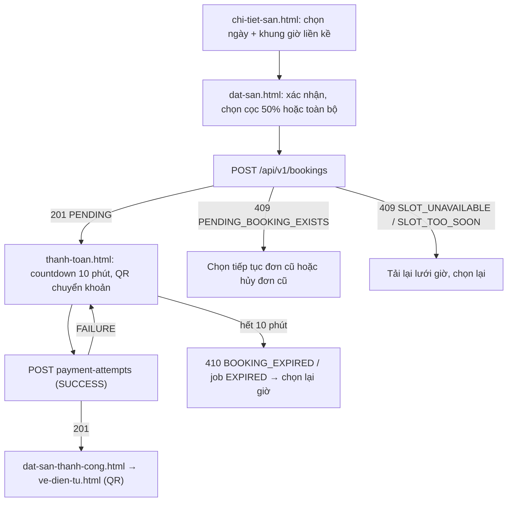

Nhánh "tiếp tục đơn cũ" không gia hạn lock — `remaining_seconds` lấy từ server. Header chung hiển thị thanh giữ chỗ trên mọi trang khách (trừ trang thanh toán/auth/admin) để không bỏ quên đơn.

| Mục | Nội dung |
|---|---|
| Tiền điều kiện | Đăng nhập; khung cùng sân/cùng ngày/liền kề; bắt đầu ≥15 phút; mỗi user tối đa 1 đơn PENDING; không có đơn PENDING khác còn hạn |
| Input | slot_ids[], payment_option DEPOSIT_50\|FULL, match_preference (tùy chọn, chỉ lưu — chưa ghép đối) |
| Backend (transaction) | Khóa user + đơn PENDING + slots (FOR UPDATE theo id) → dọn đơn hết hạn cũ (EXPIRED + trả slot + thông báo) → chặn PENDING thứ hai → validate sân/giờ mở cửa/liền kề/15 phút (tìm đối ≥30 phút) → tính tổng BigInt, cọc (total+1)/2 → hạn giữ = UTC_TIMESTAMP + 10 phút → INSERT bookings (mã SPB-…, thử lại 5 lần) + payments + booking_slots (chụp giá) → UPDATE khóa slot có điều kiện, kiểm tra affectedRows → COMMIT; deadlock → 409 BOOKING_CONFLICT |
| Frontend | booking-page.js dựng xác nhận + stepper; nhận 201 chuyển thanh-toan.html?booking_id=…; 409 kèm pending_booking_id mở lựa chọn tiếp tục/hủy |
| Lưu trữ / Output | bookings PENDING + booking_slots + payments PENDING + time_slots LOCKED; output remaining_seconds=600, amount_due, lock_expires_at |

### 10.4. Thanh toán giả lập & vé QR (FR-07)

*Hình 10.2 — Trình tự thanh toán SUCCESS (bookings.service.js).*

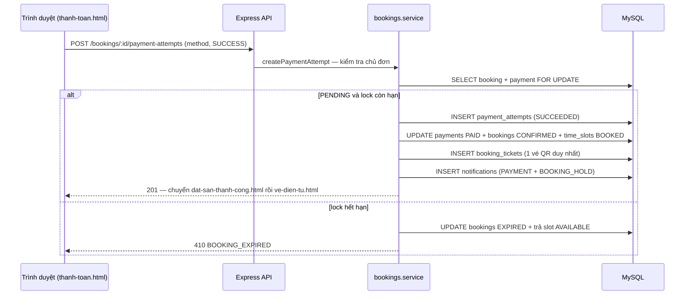

QR chuyển khoản là payload văn bản `SPORTBOOKING|mã đơn|số tiền` (không phải VietQR); QR vé là payload nhiều dòng `SPORTBOOKING/Mã đơn/Cơ sở/Ngày/Giờ`. Cả hai vẽ cục bộ bằng `assets/qr-code.js`. FAILURE vẫn ghi attempt, đơn giữ PENDING tới hết hạn; thử lại không giới hạn trong hạn.

| Mục | Nội dung |
|---|---|
| Tiền điều kiện | Đơn PENDING của chính user, lock còn hạn; số tiền nhất quán giữa booking và payments (frontend kiểm tra chéo) |
| Input | method: BANK_TRANSFER \| MOMO \| DOMESTIC_ATM \| INTERNATIONAL_CARD; simulation_result: SUCCESS \| FAILURE (nút FAILURE chỉ hiện với ?demo=1) |
| Frontend | payment-page.js: countdown 250ms từ remaining_seconds; 409 → đọc lại đơn (nếu CONFIRMED/PAID thì chuyển vé); 410 → báo hết hạn; stepper khóa quay lại bước 1 khi hết hạn |
| Backend | SUCCESS: markPaymentPaid + confirmBooking + bookSlotsForBooking + notifyPaymentSucceeded + createBookingTicket trong 1 transaction; đồng thời chỉ 1 vé (test đã chứng minh) |
| Lưu trữ / Output | payments PAID (paid_amount), payment_attempts, bookings CONFIRMED, time_slots BOOKED, booking_tickets (qr_code UNIQUE), notifications; vé hiển thị CONFIRMED/COMPLETED, đơn hủy → "VÉ ĐÃ VÔ HIỆU" |

### 10.5. Hủy đơn & hoàn tiền (FR-08)

*Hình 10.3 — Luồng hủy đơn với kiểm tra mức hoàn hai phía.*

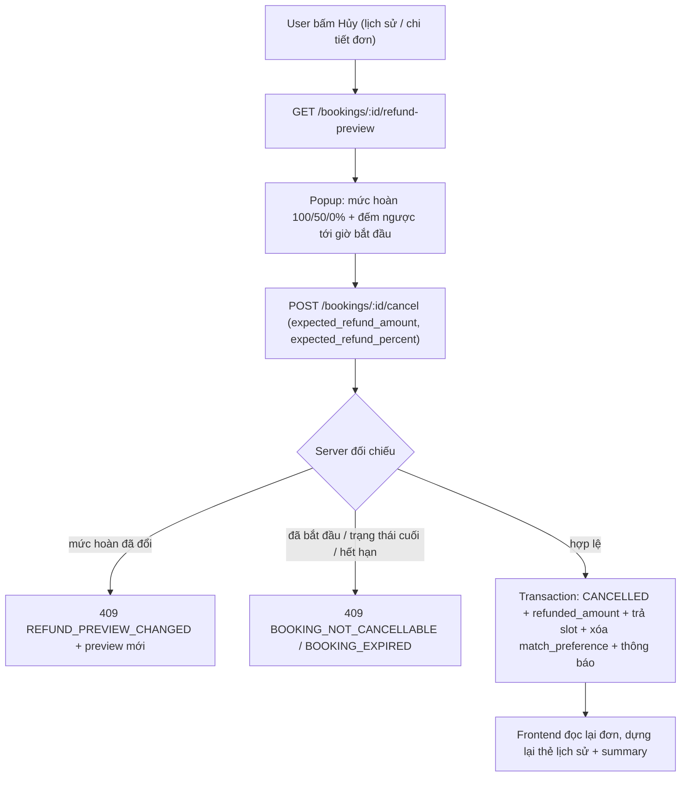

Mốc tính là giờ bắt đầu khung ĐẦU TIÊN (UTC+7). Hoàn trên `paid_amount`. PENDING chưa trả: hủy không hoàn, nhả slot. Admin hủy sự cố: hoàn 100% kể cả đang trong trận.

| Thời điểm hủy (mốc: giờ bắt đầu khung đầu, UTC+7) | Mức hoàn trên số đã trả | Trạng thái payment |
|---|---|---|
| ≥ 24 giờ trước giờ bắt đầu | 100% | REFUNDED |
| 6 – dưới 24 giờ trước giờ bắt đầu | 50% (BigInt floor) | REFUNDED (kể cả hoàn một phần) |
| < 6 giờ trước giờ bắt đầu (chưa vào trận) | User ĐƯỢC hủy · hoàn 0% | giữ PAID (refunded_amount = 0) |
| Đang trong trận hoặc đã kết thúc | User KHÔNG được hủy (409 BOOKING_NOT_CANCELLABLE) · Admin hủy sự cố: hoàn 100% | User: không đổi · Admin: REFUNDED |
| PENDING chưa thanh toán | 0 (không hoàn) | giữ PENDING, đơn CANCELLED/EXPIRED |

Đối chiếu mã nguồn: `cancellation-policy.js` (3 mức 100/50/0%), `bookings.service.js:839–841` (từ chối đơn đang diễn ra/đã hoàn thành), `cancellation.integration.test.js` (test 3 mức hoàn — hoàn 0 giữ PAID; test 409 cho đơn đang trong trận/đã kết thúc/hết hạn). Khớp `business-flow.md` mục 4.1.

### 10.6. Thông báo trong app (FR-17)

| Sự kiện | Category ghi nhận | Hàm phát sinh |
|---|---|---|
| Thanh toán thành công | PAYMENT + BOOKING_HOLD | notifyPaymentSucceeded |
| Giữ chỗ hết hạn | BOOKING_HOLD | notifyHoldExpired |
| User hủy đơn | BOOKING_HOLD (+ PAYMENT nếu có hoàn) | notifyUserCancellation |
| Admin hủy sự cố (đã trả) | BOOKING_HOLD + PAYMENT (100%) | notifyIncidentCancellation |
| Admin hủy sự cố (PENDING) | BOOKING_HOLD | notifyPendingIncidentCancellation |

Tất cả ghi trong cùng transaction với sự kiện (`notification-events.js`) — lỗi ghi thông báo sẽ rollback cả nghiệp vụ (có test). Frontend: chuông header poll unread-count 5s; trang thong-bao.html lọc theo category, đánh dấu đọc một tin/tất cả; sắp xếp `created_at DESC, id DESC`.

### 10.7. Admin: quản lý cơ sở, hủy sự cố, dashboard & export (FR-04, FR-10, FR-11, FR-19)

- **CRUD cơ sở/sân:** validate giờ mở cửa (chấp nhận đóng 24:00), đồng bộ giờ cơ sở → lưới slot; khóa lạc quan `expected_updated_at` chống ghi đè; tạo cơ sở bắt buộc ≥1 sân và sinh slot ngay; xóa chỉ khi chưa từng có đơn (nếu có → 409 FACILITY_HAS_BOOKING_HISTORY), thứ tự xóa booking_slots → time_slots → courts → facilities + audit trong 1 transaction.
- **Khung giờ & giá:** sinh thủ công ≤31 ngày; cập nhật giá chỉ áp dụng slot AVAILABLE, có `dry_run` xem trước; summary theo tháng.
- **Hủy sự cố:** reason 3–500 ký tự; chỉ PENDING/CONFIRMED; CONFIRMED hoàn 100% paid_amount; transaction khóa + kiểm tra + refund + trả slot + thông báo + audit; trạng thái cuối → 409 không đổi dữ liệu.
- **Dashboard:** range today/7d/30d; `net_revenue = gross_paid − refunded`; fill_rate, top sân, đơn gần đây; biểu đồ theo giờ/ngày. `pending_match_requests` hiện hardcode 0 (chờ module tìm đối).
- **Export Excel:** 5 báo cáo (dashboard/users/facilities/bookings/time-slots), ≤5000 dòng (vượt → 400), header tiếng Việt, escape ô `= + - @`, audit EXPORT_*; GET dashboard/users/facilities/bookings kèm ETag → 304 khi poll không đổi.
- **User:** khóa/mở khóa kèm lockReason ≤300; khóa thu hồi toàn bộ phiên; không tự khóa mình (409 ADMIN_SELF_LOCK); thống kê tỷ lệ hoàn thành/hủy, không có "bùng cọc".

### 10.8. Tác vụ nền (FR-12, FR-16)

| Job | Chu kỳ | Việc làm | Nơi cài đặt |
|---|---|---|---|
| releaseExpiredBookings | 60s | PENDING quá lock → EXPIRED, trả slot AVAILABLE, thông báo hết hạn (batch 100) | server.js + bookings.service.js |
| completeDueBookings | 60s | CONFIRMED qua giờ kết thúc khung cuối → COMPLETED (idempotent, batch 100) | server.js + bookings.service.js |
| runSlotGenerator | Khởi động + mỗi giờ (development, SLOT_GENERATOR_ENABLED) | Sinh khung giờ còn thiếu cho sân active trong SLOT_DAYS_AHEAD ngày (mặc định 14, 1–60); INSERT IGNORE; giờ vàng 17–21h theo price_peak | server.js + slot-generator.js |

"Sắp tới / Đang trong trận" không cần job — tính động khi đọc từ first_slot_start/last_slot_end theo UTC+7 (`getBookingDisplayState`). Job chỉ ghi COMPLETED và EXPIRED.

**Ý chính khi demo**
- Luồng xương sống: chọn giờ liền kề → PENDING giữ 10 phút → thanh toán giả lập → CONFIRMED + 1 vé QR → lịch sử/thông báo.
- Hủy có "bắt tay hai phía": preview mức hoàn rồi gửi expected_refund — lệch là 409, không bao giờ hoàn sai số tiền đã hiển thị.
- Mọi sự kiện (thanh toán/hủy/hết hạn) đều sinh thông báo trong cùng transaction; jobs nền chỉ dọn dẹp, không quyết định trạng thái hiển thị.

---

## Phần 11 Cài đặt · Khởi chạy · Triển khai

### 11.1. Yêu cầu môi trường

| Thành phần | Yêu cầu | Bằng chứng / ghi chú |
|---|---|---|
| Node.js | ≥ 20 (khuyến nghị 20+; máy này chạy v22.23.2) | backend/package.json engines.node = ">=20" |
| MySQL / MariaDB | MariaDB 10.4 qua XAMPP; cổng 3306 | docs/04-product/changelog.md; migrations/*.sql (InnoDB, utf8mb4_unicode_ci) |
| npm | Đi kèm Node | backend/package-lock.json |
| Internet | Cần cho Tailwind CDN (giao diện ứng dụng); bản HTML của tài liệu đã nhúng SVG nên xem được offline | Thẻ script cdn.tailwindcss.com trong các trang HTML |
| Shell | Git Bash / bash để dùng cú pháp env inline; PowerShell có cú pháp riêng bên dưới | Lệnh test trong Phần 9 |

### 11.2. Biến môi trường (chỉ liệt kê TÊN — không chứa giá trị bí mật)

Nguồn: `backend/.env.example`. File `.env` thật đã nằm trong `.gitignore`; tài liệu này không đọc/không hiển thị giá trị của nó.

| Biến | Mục đích |
|---|---|
| APP_ENV | development \| test — quyết định guard DB và log stack lỗi |
| PORT | Cổng HTTP (mẫu: 3000) |
| DB_HOST / DB_PORT | Địa chỉ MySQL |
| DB_NAME / DB_NAME_TEST | DB chạy thật (sportbooking_dev) / DB test (sportbooking_test) |
| DB_USER / DB_PASSWORD | Tài khoản DB (mẫu: sportbooking_app) — mật khẩu chỉ nằm trong .env cục bộ |
| BCRYPT_ROUNDS | Số vòng bcrypt (mẫu: 12) |
| SESSION_COOKIE_NAME / SESSION_TTL_HOURS / COOKIE_SECURE | Tên cookie phiên, TTL 8h, bật secure khi có HTTPS |
| ADMIN_PASSWORD_HASH | Hash bcrypt của mật khẩu admin dùng cho seed — không lưu mật khẩu thô |
| SLOT_DAYS_AHEAD / SLOT_GENERATOR_ENABLED | Cửa sổ sinh khung giờ (mặc định 14) và bật/tắt job sinh slot |

### 11.3. Các bước cài đặt & khởi chạy (lệnh thật từ scripts)

1. **Tạo database & user DB** (thao tác MySQL thủ công): tạo `sportbooking_dev` và `sportbooking_test`; tạo user `sportbooking_app` chỉ có quyền trên 2 DB này. Không dùng root cho ứng dụng.
2. **Cài dependency:** `cd backend && npm install`
3. **Tạo cấu hình:** chép `backend/.env.example` thành `backend/.env` rồi điền giá trị cục bộ (không commit).
4. **Migration 001 (auth):** áp dụng thủ công file `infra/database/migrations/001-create-auth-tables.sql` vào DB đích — không có runner riêng cho 001.
5. **Migration 002:** `node infra/database/migrate-facilities.js --database sportbooking_dev`
6. **Migration 003–008:** `node infra/database/migrate-bookings.js --database sportbooking_dev` (idempotent, tự xác minh sau áp dụng)
7. **Seed 29 cơ sở:** `cd backend && npm run seed:facilities` (đọc `infra/data/khao-sat-san.xlsx`, sinh sân + khung giờ)
8. **Seed admin:** đặt `ADMIN_PASSWORD_HASH` (hash bcrypt tạo sẵn) rồi chạy `node infra/database/seed-admin.js` — idempotent, không ghi đè admin đã có.
9. **Khởi chạy:** `cd backend && npm start` → mở `http://localhost:3000` (tự chuyển tới `/dang-nhap.html`). Một tiến trình phục vụ cả giao diện lẫn API.
10. **Chuẩn bị DB test:** lặp lại bước 4–6 với `--database sportbooking_test` để chạy được bộ test.

Chạy test (Git Bash / bash):

```bash
cd backend  && npm test          # 93 test — run-tests.js tự ép APP_ENV=test + sportbooking_test
cd frontend && APP_ENV=test DB_NAME=sportbooking_test \
  node --test --test-concurrency=1 tests/*.test.js    # 232 test
```

Chạy test frontend (PowerShell — cú pháp env khác):

```powershell
cd frontend
$env:APP_ENV='test'; $env:DB_NAME='sportbooking_test'
node --test --test-concurrency=1 tests/*.test.js
```

### 11.4. Mô hình triển khai

Triển khai cục bộ là lựa chọn **có chủ đích** cho quy mô đồ án: kiến trúc monolith cùng origin khiến toàn hệ thống chỉ cần Node.js + MySQL trên một máy, khởi động bằng một lệnh `npm start` — không phụ thuộc hạ tầng ngoài, dễ tái lập khi chấm demo. `COOKIE_SECURE` mặc định false, đúng chuẩn cho HTTP localhost. Lộ trình nâng cấp production đã xác định rõ: bật HTTPS + `COOKIE_SECURE=true`, tách DB production riêng, bổ sung quy trình migration/backup; mã nguồn không cần thay đổi kiến trúc vì mọi cấu hình đã nằm trong biến môi trường.

*Hình 11.1 — Sơ đồ triển khai thực tế (máy cá nhân).*

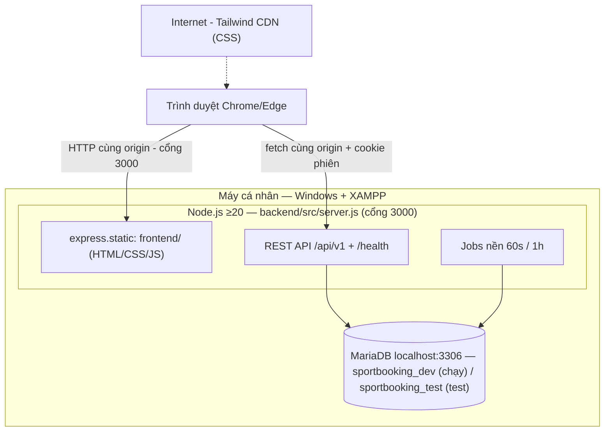

Toàn bộ hệ thống nằm trên một máy: trình duyệt → Express (static + API) → MariaDB. Không có server ngoài, không CDN cho ảnh/API; chỉ Tailwind và font tải từ Internet.

### 11.5. Lỗi thường gặp và cách xử lý

| Hiện tượng | Nguyên nhân | Cách xử lý |
|---|---|---|
| "APP_ENV must be development or test" / từ chối DB | Sai APP_ENV hoặc DB_NAME không thuộc allowlist | Đặt APP_ENV=development, DB_NAME=sportbooking_dev (test: sportbooking_test) |
| Test từ chối chạy / "Refusing to run tests outside a dedicated test database" | DB_NAME không kết thúc bằng _test | Dùng npm test (backend) hoặc gắn đủ env (frontend) |
| ECONNREFUSED 127.0.0.1:3306 | MySQL/XAMPP chưa bật | Bật MySQL trong XAMPP Control Panel |
| ER_ACCESS_DENIED_ERROR | Sai DB_USER/DB_PASSWORD trong .env | Kiểm tra lại .env và quyền của sportbooking_app |
| EADDRINUSE cổng 3000 | Ứng dụng khác chiếm cổng | Đổi PORT trong .env hoặc tắt tiến trình chiếm cổng |
| Bị đá về đăng nhập liên tục (401) | Cookie bị chặn / phiên hết hạn 8h / tài khoản bị khóa | Cho phép cookie localhost; đăng nhập lại; kiểm tra account_status |
| Giao diện vỡ kiểu chữ/màu | Mất mạng → Tailwind CDN không tải | Khôi phục Internet; giao diện cần CDN này |
| 1 file test frontend fail khi chạy không env | Guard của booking-cancellation-http.test.js | Gắn APP_ENV=test + DB_NAME=sportbooking_test |
| node --test tests/ báo MODULE_NOT_FOUND (Node 22) | Dạng thư mục không tương thích trên máy này | Dùng glob: tests/*.test.js |

**Ý chính khi demo**
- Chạy demo chỉ cần: XAMPP bật MySQL + .env đúng + npm start → localhost:3000; một tiến trình lo cả web lẫn API.
- Migration/seed idempotent và có allowlist DB — chạy lại không phá dữ liệu; test không bao giờ đụng DB thật.
- Triển khai cục bộ là thiết kế có chủ đích; lộ trình production (HTTPS + COOKIE_SECURE, DB riêng, backup) đã xác định rõ và không đòi hỏi đổi kiến trúc.

---

## Phần 12 Phụ lục A — API & Module (tra cứu nhanh)

### 12.1. Bảng API đầy đủ (46 endpoint)

Input/Output đối chiếu theo code routes + service; phân trang mặc định `page=1`, `page_size≤50` (admin users mặc định 20). Mọi response lỗi có dạng `{error:{code,message,details?}}`. Tóm tắt theo nhóm ở Phần 6.4.

| # | Method | Endpoint | Chức năng | Input chính | Output | Quyền |
|---|---|---|---|---|---|---|
| **Auth — /api/v1/auth** | | | | | | |
| 1 | POST | /api/v1/auth/register | Đăng ký tài khoản | fullName, email, phone, password (8–72 byte), termsAccepted=true | 201 {user} | Công khai |
| 2 | POST | /api/v1/auth/login | Đăng nhập, đặt cookie phiên | email, password | 200 {user} + cookie 8h | Công khai |
| 3 | POST | /api/v1/auth/logout | Đăng xuất, thu hồi phiên | cookie | 204 | Đăng nhập |
| 4 | GET | /api/v1/auth/me | Thông tin user hiện tại | cookie | 200 {user} | Đăng nhập |
| **Users — /api/v1/users** | | | | | | |
| 5 | PATCH | /api/v1/users/me | Cập nhật hồ sơ | fullName / phone / gender / skillLevel | 200 {user} | Đăng nhập |
| 6 | PATCH | /api/v1/users/me/password | Đổi mật khẩu | currentPassword, newPassword | 204 | Đăng nhập |
| **Facilities — /api/v1 (requireAuth, no-store)** | | | | | | |
| 7 | GET | /api/v1/facilities | Danh sách + tìm kiếm cơ sở | sport, district, q, date (14 ngày), time_band, page, page_size | 200 danh sách + phân trang | Đăng nhập |
| 8 | GET | /api/v1/facilities/:id | Chi tiết cơ sở + sân con | path id | 200 {facility, courts} | Đăng nhập |
| 9 | GET | /api/v1/courts/:id/time-slots | Lưới khung giờ + trạng thái chọn được | date hoặc from/to | 200 slots (is_selectable, unavailable_reason) | Đăng nhập |
| **Bookings — /api/v1/bookings** | | | | | | |
| 10 | POST | /api/v1/bookings | Tạo đơn + giữ chỗ 10 phút | slot_ids[], payment_option (DEPOSIT_50\|FULL), match_preference? | 201 booking (remaining_seconds=600) | Đăng nhập |
| 11 | GET | /api/v1/bookings?mine=true | Lịch sử đơn của tôi | status, q≤100, sport, page, page_size≤50 | 200 bookings + display_status | Đăng nhập |
| 12 | GET | /api/v1/bookings/pending | Đơn PENDING còn hạn của tôi | — | 200 booking hoặc null | Đăng nhập |
| 13 | GET | /api/v1/bookings/summary | Tóm tắt số đơn theo trạng thái + tổng chi | — | 200 counts_by_status, total_spent | Đăng nhập |
| 14 | GET | /api/v1/bookings/:id | Chi tiết đơn | path id | 200 booking + slots + payment | Chủ đơn |
| 15 | GET | /api/v1/bookings/:id/refund-preview | Xem trước mức hoàn tiền | path id | 200 refund_amount/percent, seconds_until_start, server_time | Chủ đơn |
| 16 | POST | /api/v1/bookings/:id/cancel | Hủy đơn + hoàn tiền + trả slot | expected_refund_amount, expected_refund_percent (tùy chọn, chống lệch) | 200 booking đã hủy | Chủ đơn |
| 17 | POST | /api/v1/bookings/:id/payment-attempts | Gửi kết quả thanh toán giả lập | method (4 loại), simulation_result (SUCCESS\|FAILURE) | 201 attempt + trạng thái đơn | Chủ đơn |
| 18 | GET | /api/v1/bookings/:id/payments | Lịch sử thanh toán của đơn | path id | 200 payment + attempts | Chủ đơn / Admin |
| **Notifications — /api/v1/notifications (no-store)** | | | | | | |
| 19 | GET | /api/v1/notifications/unread-count | Số thông báo chưa đọc | — | 200 {unread_count} | Đăng nhập |
| 20 | GET | /api/v1/notifications | Danh sách thông báo | category, page, page_size≤50 | 200 notifications + server_time | Đăng nhập |
| 21 | POST | /api/v1/notifications/read-all | Đánh dấu tất cả đã đọc | — | 200 | Đăng nhập |
| 22 | PATCH | /api/v1/notifications/:id/read | Đánh dấu một tin đã đọc | path id | 200 (404 nếu không sở hữu) | Chủ sở hữu |
| **Admin — /api/v1/admin (requireAuth + requireAdmin; GET no-cache + ETag, ghi no-store)** | | | | | | |
| 23 | GET | /api/v1/admin/users | Danh sách user + thống kê | status, q, page, page_size (mặc định 20) | 200 users + stats + summary tháng | Admin |
| 24 | GET | /api/v1/admin/users/export | Xuất Excel người dùng | bộ lọc như trên | xlsx ≤5000 dòng (audit EXPORT_USERS) | Admin |
| 25 | PATCH | /api/v1/admin/users/:id/lock | Khóa tài khoản + thu hồi phiên | lockReason ≤300 ký tự | 200 (409 nếu tự khóa mình) | Admin |
| 26 | PATCH | /api/v1/admin/users/:id/unlock | Mở khóa tài khoản | — | 200 | Admin |
| 27 | GET | /api/v1/admin/facilities | Danh sách cơ sở (admin) + KPI toàn hệ thống | bộ lọc | 200 facilities + stats | Admin |
| 28 | GET | /api/v1/admin/facilities/export | Xuất Excel cơ sở | bộ lọc | xlsx ≤5000 dòng | Admin |
| 29 | GET | /api/v1/admin/facilities/:id | Chi tiết cơ sở phía admin | path id | 200 facility + courts | Admin |
| 30 | POST | /api/v1/admin/facilities | Tạo cơ sở (bắt buộc ≥1 sân) + sinh slot | thông tin cơ sở + courts[] | 201 | Admin |
| 31 | PATCH | /api/v1/admin/facilities/:id | Sửa cơ sở (khóa lạc quan) | trường sửa + expected_updated_at | 200 (409 ADMIN_STALE_DATA nếu dữ liệu cũ) | Admin |
| 32 | DELETE | /api/v1/admin/facilities/:id | Xóa cơ sở chưa từng có đơn | expected_updated_at | 200 (409 FACILITY_HAS_BOOKING_HISTORY nếu có đơn) | Admin |
| 33 | POST | /api/v1/admin/courts | Thêm sân con | facility_id, name, sport_type, giá | 201 | Admin |
| 34 | PATCH | /api/v1/admin/courts/:id | Sửa sân (tên, trạng thái, giờ…) | trường sửa + expected_updated_at | 200 | Admin |
| 35 | GET | /api/v1/admin/courts/:id/time-slots/summary | Tổng hợp khung giờ theo tháng | month | 200 summary | Admin |
| 36 | GET | /api/v1/admin/time-slots/export | Xuất Excel khung giờ | court_id, date/from/to | xlsx ≤5000 dòng | Admin |
| 37 | GET | /api/v1/admin/time-slots | Danh sách khung giờ | court_id, date hoặc from/to | 200 slots | Admin |
| 38 | POST | /api/v1/admin/courts/:id/generate-slots | Sinh khung giờ thủ công | from/to (≤31 ngày) | 201 số slot đã sinh | Admin |
| 39 | PATCH | /api/v1/admin/courts/:id/prices | Cập nhật giá (chỉ slot AVAILABLE) | giá + dry_run true\|false | 200 (dry_run: chỉ xem trước) | Admin |
| 40 | GET | /api/v1/admin/bookings | Danh sách đơn toàn hệ thống | status, q, facility_id, date, page | 200 bookings + can_cancel_incident + owner | Admin |
| 41 | GET | /api/v1/admin/bookings/export | Xuất Excel đơn đặt sân | bộ lọc | xlsx ≤5000 dòng, header tiếng Việt | Admin |
| 42 | GET | /api/v1/admin/bookings/:id | Chi tiết đơn phía admin (popup) | path id | 200 đầy đủ đơn + slots + payment | Admin |
| 43 | POST | /api/v1/admin/bookings/:id/incident-cancellation | Hủy sự cố (hoàn 100% nếu đã trả) | reason 3–500 ký tự | 200 (409 nếu trạng thái cuối) | Admin |
| 44 | GET | /api/v1/admin/dashboard/export | Xuất Excel dashboard | range | xlsx (audit EXPORT_DASHBOARD) | Admin |
| 45 | GET | /api/v1/admin/dashboard | KPI + chuỗi biểu đồ + top sân + đơn gần đây | range today\|7d\|30d (hoặc period) | 200 dashboard (net_revenue, fill_rate…) | Admin |
| **Health** | | | | | | |
| 46 | GET | /health | Kiểm tra server sống | — | 200 {status:'ok'} | Công khai |

### 12.2. Danh sách module & trạng thái

| # | Module | FR | Trạng thái |
|---|---|---|---|
| 1 | Auth & hồ sơ | FR-01, FR-03 | COMPLETED |
| 2 | Danh mục sân, seed, trang chủ, tìm sân | FR-04, FR-05 | COMPLETED |
| 3 | Admin cơ sở/sân/giờ | FR-04 | COMPLETED |
| 4 | Đặt sân & giữ chỗ | FR-06, FR-12 | COMPLETED |
| 5 | Thanh toán giả lập & vé QR | FR-07 | COMPLETED |
| 6 | Hủy & hoàn tiền | FR-08 | COMPLETED |
| 7 | Lịch sử đặt sân | FR-09 | COMPLETED |
| 8 | Thông báo trong app | FR-17 | COMPLETED |
| 9 | Đánh giá sân | FR-18 | NOT STARTED |
| 10 | Admin dashboard/user/ngoại lệ | FR-10, FR-11, FR-19 | COMPLETED |
| 11 | Tìm đối, ghép, nới lỏng | FR-13–15 | NOT STARTED |
| 12 | Realtime polling 5s | FR-16 | COMPLETED (roadmap: Đang làm — chưa xác nhận bằng trình duyệt; ghép đối chờ module 11) |
| 13 | Hotline & trạng thái vé | FR-07, FR-09 | COMPLETED |
| 14 | Quên mật khẩu / RSS / email | — | NOT STARTED |

### 12.3. File then chốt cần nhớ

- **Backend:** `src/app.js`, `src/server.js`, `src/config/database.js`, `src/bookings/bookings.service.js`, `src/bookings/bookings.repository.js`, `src/bookings/cancellation-policy.js`, `src/facilities/slot-availability.js`, `src/admin/admin.service.js`.
- **Frontend:** `shared/app.js`, `shared/header.js`, `booking/bookings-api.js`, `booking/payment-page.js`, `booking/ticket-data.js`, `admin/admin-shell.js`, `assets/qr-code.js`.
- **Infra & tài liệu:** `infra/database/migrations/001–008`, `infra/database/seed-facilities.js`, `docs/01-plan/business-flow.md`, `docs/04-product/roadmap.md`.

**Ý chính khi demo**
- Phụ lục này là bảng tra nhanh khi bị hỏi bất ngờ: đầy đủ 46 API kèm input/output/quyền, 14 module kèm trạng thái, file then chốt.
- Phần 6 tóm tắt API theo nhóm; bảng chi tiết từng endpoint ở 12.1; trạng thái module có bằng chứng ở Phần 8.

---

## Phần 13 Phụ lục B — Thuật ngữ, Framework & Tham khảo

### 13.1. Thuật ngữ

| Thuật ngữ | Giải thích ngắn |
|---|---|
| PENDING / CONFIRMED / COMPLETED / CANCELLED / EXPIRED | Vòng đời đơn: chờ thanh toán → đã xác nhận → đã chơi xong → bị hủy → hết hạn giữ chỗ |
| AVAILABLE / LOCKED / BOOKED | Trạng thái khung giờ: trống → đang giữ (có hạn) → đã đặt |
| Hold / giữ chỗ | Khóa tạm khung giờ 10 phút cho đơn PENDING; hết hạn tự nhả |
| Deposit (DEPOSIT_50) / FULL | Cọc 50% (phần còn lại thu tại sân) hoặc trả toàn bộ qua hệ thống |
| Giờ vàng (peak) | 17:00–21:00, áp price_peak thay vì price_normal |
| Lead time | Khoảng cách tối thiểu từ hiện tại đến giờ bắt đầu khung đặt được (15 phút; bật tìm đối 30 phút) |
| Transaction | Nhóm thao tác DB "tất cả hoặc không gì"; lỗi giữa chừng → ROLLBACK |
| SELECT … FOR UPDATE | Khóa dòng đang đọc trong transaction, chặn giao dịch khác sửa cùng dòng |
| Deadlock | Hai transaction chờ khóa lẫn nhau; MySQL tự hủy một bên → backend trả 409 BOOKING_CONFLICT |
| Khóa lạc quan (expected_updated_at) | Ghi kèm phiên bản dữ liệu đã đọc; lệch → 409, tránh ghi đè thay đổi của người khác |
| ETag / 304 | Dấu vân tay response; client gửi lại If-None-Match, server trả 304 (không đổi) để tiết kiệm băng thông |
| Polling | Client định kỳ hỏi server (ở đây 5 giây) — thay cho push/WebSocket |
| Session cookie httpOnly | Cookie phiên JavaScript không đọc được, giảm rủi ro XSS đánh cắp phiên |
| bcrypt / SHA-256 | Băm mật khẩu (chậm, có salt) / băm token phiên (nhanh, một chiều) — DB không lưu giá trị gốc |
| BigInt | Số nguyên JS không giới hạn độ lớn — dùng tính tiền VND tránh sai số dấu phẩy động |
| UMD | Mẫu module chạy được cả trình duyệt (window.*) lẫn Node (module.exports) |
| Migration / Seed | Script tạo/đổi schema có kiểm soát / nạp dữ liệu ban đầu (29 cơ sở, admin) |
| Idempotent | Chạy lại nhiều lần cho cùng kết quả (migration, job COMPLETED, sinh slot) |
| DFD / ERD / Use Case | Sơ đồ luồng dữ liệu / sơ đồ quan hệ thực thể / sơ đồ ca sử dụng |
| FR / UC | Functional Requirement (yêu cầu chức năng) / Use Case — mã giữ theo phiếu yêu cầu |
| Formula injection | Ô Excel bắt đầu bằng `= + - @` có thể thành công thức độc hại; export thêm dấu ' để vô hiệu |
| VietQR | Chuẩn QR chuyển khoản ngân hàng VN — dự án KHÔNG dùng; QR chuyển khoản chỉ là payload văn bản nội bộ |

### 13.2. Framework / thư viện & tài liệu chính thức

| Công nghệ | Vai trò trong dự án | Tài liệu chính thức |
|---|---|---|
| Node.js | Runtime backend + test runner | nodejs.org/docs |
| Express 5 | Web framework, routing, middleware | expressjs.com |
| mysql2 | Driver MySQL (pool, promise, prepared statements) | github.com/sidorares/node-mysql2 |
| bcrypt | Băm mật khẩu | github.com/kelektiv/node.bcrypt.js |
| dotenv | Nạp biến môi trường từ .env | github.com/motdotla/dotenv |
| ExcelJS | Xuất Excel admin + đọc file seed | github.com/exceljs/exceljs |
| Tailwind CSS (CDN) | Utility CSS cho giao diện | tailwindcss.com/docs |
| node:test | Framework test tích hợp (cả 2 phía) | nodejs.org/api/test.html |
| MySQL / MariaDB | Hệ quản trị cơ sở dữ liệu | dev.mysql.com/doc · mariadb.com/kb |

### 13.3. Tài liệu nội bộ của dự án

- `docs/01-plan/phieu-yeu-cau.md` — phiếu yêu cầu gốc (chỉ đọc).
- `docs/01-plan/business-flow.md` — nguồn sự thật nghiệp vụ: FR/UC, luồng chính 10 bước, bảng trạng thái, 16 quy tắc + 21 quyết định, 12 ngoại lệ.
- `docs/02-design/spec.md` — thiết kế; `docs/02-design/terms-and-privacy.md` — văn bản pháp lý nhúng trong đăng ký.
- `docs/03-build/plan-*.md` — 20 kế hoạch tính năng (duyệt trước khi code).
- `docs/04-product/roadmap.md` — trạng thái 14 module; `docs/04-product/changelog.md` — lịch sử thay đổi + kết quả test từng mốc.
- `AGENTS.md` / `CLAUDE.md` — luật dự án; `backend/.env.example` — mẫu cấu hình.

**Ý chính khi demo**
- Gặp thuật ngữ lạ (hold, ETag, khóa lạc quan…) đã có giải thích ngắn ở 13.1 — dùng khi trả lời câu hỏi phản biện.
- Mọi công nghệ đều có link tài liệu chính thức; mọi quy tắc nghiệp vụ đều truy về `business-flow.md`.

---

*SportBooking — Tài liệu dự án (bản đọc Markdown) · Biên soạn 15/11/2026 từ phân tích toàn bộ repository · Chuyển từ bản HTML `PROJECT_STRUCTURE_AND_CODE_GUIDE.html` (sơ đồ SVG nhúng, xem offline).*

*Kết quả test trong tài liệu là kết quả chạy thật ngày 15/11/2026 trên `sportbooking_test`. Tài liệu không chứa giá trị bí mật (.env, mật khẩu, token); không chỉnh sửa bất kỳ file source nào của dự án.*
